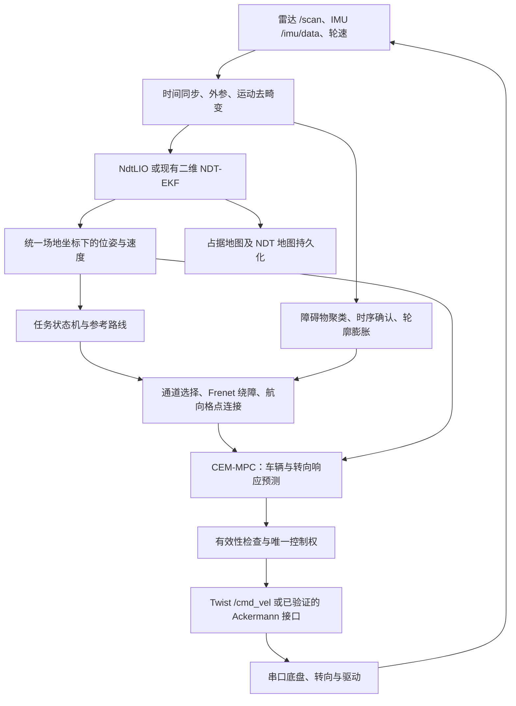

# OriginCar 实车导航：从 NdtLIO 定位建图到多锥桶避障与 MPC

本项目面向多区域智能车比赛，围绕定位稳定性、多锥桶连续绕行、转向平顺性和全流程任务衔接，组织从感知到执行的完整导航方案。

技术路线：传感器与标定 → 定位建图 → 地图保存与重定位 → 比赛路线与任务管理 → 障碍物感知 → 局部规划 → MPC 跟踪 → 底盘执行 → 数据记录与验证。本文介绍实车系统的方法、接口和部署路径，不包含仿真场景。

## 项目特色与创新点

创新重点是针对比赛场景的规划、控制与系统协同设计。NDT、Frenet、MPC 和 CEM 是采用的已有技术方法；下述贡献体现在它们的组合方式、车辆约束和赛段适配，实际部署进度见后面的实现状态表。

### 1. 面向多锥桶的连续通道规划

将前方多个锥桶、场地边界和路线汇合段放入同一规划窗口。C 区以 Frenet 五次侧向偏移曲线生成平滑绕行候选，同时约束起始航向、曲率和汇合姿态；跨控制周期保留可行绕行侧，减少锥桶之间左右反复选路。

针对入口、出口、窄通道和倒车连接，组合带航向的车辆运动原语与解析连接。两类规划共用整车碰撞约束，使连续绕行与复杂姿态连接能够衔接。设计目标是减少逐桶避让带来的折线和不必要停顿。详见 [双层局部规划](docs/zsh/02_mission_planning_mpc.md#4-双层局部规划)。

### 2. 将转向执行器响应纳入 MPC 预测

在车辆运动学之外，加入转向增益、阻尼、响应速度及延迟，预测实际轮角的变化。CEM 在几何反馈与曲率前馈引导下，联合搜索转向修正和速度比例，转角速率与加减速限制直接作用于预测过程。

这一设计针对前轮抖动、指令与实际转弯半径不一致、出弯回正迟缓等问题，让控制决策考虑底盘真实响应。求解采用低维参数化、上一周期解热启动和固定采样预算，便于控制计算耗时；模型参数及实时性仍需实车标定与测量。详见 [车辆模型与 CEM-MPC](docs/zsh/02_mission_planning_mpc.md#5-车辆与转向响应模型)。

### 3. 从激光点避让扩展到整车扫掠与锥桶底座约束

激光扫描通常只看到锥桶某一高度的截面。方案在拟合可靠时结合已标定尺寸恢复底座轮廓，并将车辆宽度、前后悬、车尾和运动扫掠区域一起纳入检查；观测不可靠时保留保守包络。

规划与控制统一后轴、车体及传感器参考点，并校验绕行结束后的整段汇合路径，针对“车头通过、底座或车尾仍碰撞”的问题建立一致的几何约束。详见 [多锥桶感知链](docs/zsh/02_mission_planning_mpc.md#3-多锥桶感知链)。

### 4. 定位与避障共享时空基准、分别处理环境结构

定位侧保留墙体等稳定几何信息进行 NDT 匹配；避障侧独立完成墙段识别、锥桶确认和短期障碍记忆。两条处理链共享时间同步、扫描去畸变和场地坐标变换，避免控制侧过滤背景时破坏定位结构。

同时将定位质量、数据年龄与重定位状态接入导航有效性判断，使规划结果与其使用的位姿、地图保持一致。详见 [定位建图与坐标统一](docs/zsh/01_ndtlio_mapping_localization.md)。

### 5. 赛段驱动的异步规划与速度协调

将 A/B/C 区、倒车转移、环道方向和返回停车统一为赛段状态机，提前准备下一段连接；后台规划结果携带任务、地图、障碍和定位版本，控制侧重新验证后再切换，减少等待规划造成的中断。

速度规划综合曲率、制动距离、执行延迟和定位质量，提前减速并在条件允许时恢复速度。控制权释放确认、实际静止判定和唯一命令出口贯穿任务交接，保证全流程衔接有明确条件。详见 [任务与异步规划](docs/zsh/02_mission_planning_mpc.md) 和 [接口与控制权](docs/zsh/03_interfaces_bringup.md)。

上述内容是方案的技术贡献与设计目标；定量收益需要通过同场景、同约束的重复实车测试确认，验收方法见 [实车迁移与验证](docs/zsh/04_validation_migration.md)。

## 当前实现与部署状态

当前分支同时提供二维定位与路径控制源码，以及独立的 [zsh_navigation 算法包](src/zsh_navigation/README.md)。新包包含全赛段任务状态机、Frenet 多锥桶通道规划、航向格点搜索、锥桶轮廓处理、CEM-MPC 和真实 ROS 话题接入，未包含仿真场景。源码交付与实车验收分别说明如下：

| 部分 | 当前状态 | 使用边界 |
| --- | --- | --- |
| 本仓库 `lio_hybird` | 已有二维 NDT-EKF、Pure Pursuit、局部避障和任务交接源码 | 当前可用的路径控制实现；CEM-MPC 需按文档接入 |
| 小车 `zsh_pkg` 的 NdtLIO 试运行 | 独立代码，提供 `test_ros2_lio`、`process_imu` 两个入口；本次未复制其定位核心 | 试运行配置 `with_imu: 0` 为纯雷达 LO；IMU 融合需单独启用与验证 |
| `zsh_navigation` 多锥桶规划与 CEM-MPC | 已交付算法源码、ROS 节点、启动配置、路线和离线回归检查 | 安装入口为 `full_race_navigation` 与 `audit_course`；默认预览，实车标定、定位接线和闭环验收待现场完成 |

定位模式、控制器和启动入口应配套使用。`lio_hybird` 的路径控制为 Pure Pursuit，`zsh_navigation` 的路径控制为 CEM-MPC；历史说明中的 TEB 对应其他实现，部署时按实际安装的节点和参数确认。

## 总体实现路径



上图包含完整系统的接入目标。当前 `zsh_navigation` 已实现导航与控制部分；NdtLIO 地图持久化、重定位及定位质量协议仍需补齐。`pure_pursuit_node` 与新 MPC 是两种控制入口，接底盘时选择一个或接入统一仲裁。

### 1. 传感器与底盘

- 雷达提供 `sensor_msgs/msg/LaserScan`；必须核对扫描起止时间、束顺序和雷达外参。
- IMU 经安装方向、零偏和时间检查后使用；不能把另一台设备的噪声与零偏直接当作本车标定结果。
- 当前 `base_orin` 提供原始轮速里程计 `/odom`、`/robotvel`、原始 IMU `/imu/data_raw`；上层还有 `/imu/data` 和 `/odom_combined`。
- `/odom` 与 `/odom_combined` 是不同来源。现有 NDT-EKF 取原始轮速的纵向速度，不把另一个融合器的位姿当独立观测再次融合。

### 2. NdtLIO 定位建图

先让时间、外参和扫描运动补偿正确，再将雷达点匹配到局部 NDT 高斯体素地图；有可信 IMU 时用滤波器预测状态，再用匹配残差更新。建图阶段按距离和转角选关键帧，维护局部地图和占据地图。

独立 NdtLIO 的 `with_imu` 分别为 `0=LO`、`1=ESKF LIO`、`2=IESKF LIO`。现有试运行使用 0；本仓库 `lio_hybird` 则是二维五状态 NDT-EKF，不能与上述三维惯性状态实现混称。

建图之后必须补齐地图重载、初始位姿注入、匹配质量判定和重定位成功门控。保存 PGM/YAML 仅保存占据地图，不代表保存了 NDT 体素统计量，也不代表定位节点会自动载入它。详见 [定位建图与重定位](docs/zsh/01_ndtlio_mapping_localization.md)。

### 3. 坐标统一和定位质量

路线、障碍物和车辆轮廓必须进入同一个场地坐标。将地图坐标对齐场地坐标，核对估计位姿对应的是雷达、IMU、车体还是后轴中心；传感器位置不能直接当作车体中心。

真实底盘的 `odom → base_footprint` 已由既有融合链路维护。新的定位器应发布独立全局修正或由控制器直接订阅其位姿，避免重复发布同一条 TF。过期、跳变、坐标系错误或重定位未完成时，控制器不能继续使用旧位姿高速行驶。

### 4. 比赛任务和路线

路线按任务拆段，每段包含路径、行驶方向、速度上限、入口条件和退出条件。以下对应 `race_course.py` 和 `RaceMission` 中的导航赛段；二维码和图生文仍作为独立任务扩展：


每次切段同时检查位置、航向、实际速度和车辆尾部是否通过边界；倒车换挡先确认实际速度接近零。二维码可以决定环道方向，拍照和图生文作为任务扩展，不应阻塞定位与控制。没有推理服务时不能把“拍照成功”当作“图生文完成”。

### 5. 多锥桶感知和自然绕障

原始扫描保留给定位；控制使用单独的障碍物处理链。将激光点按测量时刻补偿到共同坐标后聚类，做时序确认，区分墙体和独立锥桶。仅在几何拟合可靠时用已标定锥桶尺寸还原底座轮廓；否则保守保留原始点。

绕障不能只绕过当前最近锥桶。规划时同时检查前方多个障碍、整车矩形和扫掠区域、通道边界、路线汇合点以及车辆尾部。C 区采用连续侧向偏移曲线，跨帧保留可行绕行侧，减少左右反复切换；狭窄连接和倒车使用带航向的车辆运动原语。没有可行通道时应减速或停车，不能为了“不停”穿过障碍。

### 6. MPC 控制与抖动治理

目标控制器采用**车辆模型预测 + CEM 采样优化 + 几何反馈引导**。优化短时域内的转向修正和速度比例，代价包含横向误差、航向误差、进度、速度以及转向变化；碰撞、禁行区域、转角、转角速率和加减速作为约束。

预测模型包括实际转向响应，而非假定前轮瞬间到达指令角。输出仅执行最前面一小步，再用新状态重新求解。转向限速必须进入预测，若求解后才滤波，实际车辆运动将偏离已检查的轨迹。

车速由曲率、可用制动距离、定位质量和执行延迟共同限制。单独增大最高速度既不能保证全程更快，也不能解决 C 区僵硬和前轮抖动。算法公式、候选生成、异步规划和失败处理见 [规划、避障与 MPC](docs/zsh/02_mission_planning_mpc.md)。

### 7. 底盘接口

当前默认启动配置为 `akmcar: false`，使用 `geometry_msgs/msg/Twist` 的 `/cmd_vel`：`linear.x` 单位 m/s，`angular.z` 单位 rad/s，**不是前轮转角**。若 MPC 内部输出速度 `v` 和转角 `δ`，按已标定轴距 `L` 转成 `ω = v tan(δ) / L`。

仓库另有 Ackermann 转换路径，但必须结合启动参数和下位机协议验证后使用。不得同时启用两个不一致的命令路径，也不能假定零速转角保持在默认串口路径上已受支持。详见 [接口与实车启动](docs/zsh/03_interfaces_bringup.md)。

## 当前实车启动入口

新算法源码位于 [src/zsh_navigation](src/zsh_navigation/README.md)。由用户在小车本机安装后启动预览：

```bash
cd /userdata/dev_ws
colcon build --packages-select zsh_navigation --symlink-install
source install/local_setup.bash
ros2 run zsh_navigation audit_course
ros2 launch zsh_navigation navigation.launch.py direction:=CW
```

默认 `publish_drive=false`，不向底盘话题发布命令；收到有效定位、轮速和雷达后，通过 `/zsh_navigation/enable` 服务启用预览计算。配置、前提和实车输出方法见 [包使用说明](src/zsh_navigation/README.md)。本次未在小车执行构建或运动测试。

以下保留现有 `lio_hybird` 入口，供使用 Pure Pursuit 版本时选择。不要让它与新 MPC 同时给底盘发速度：

```bash
cd /userdata/dev_ws
source install/local_setup.bash
ros2 pkg executables lio_hybird
ros2 launch lio_hybird lio_hybird.launch.py \
  pre_qr_control_mode:=external post_qr_route_mode:=parking
```

如采用二维码前视觉控制，再另开终端运行 `ros2 run origincar_control origincar_control`。该程序有键盘启动流程；先确认环境和当前控制阶段。现有交接使用 `/sign_switch` 和 `/origincar_control/control_released`，接管前检查实际轮速，不能只按固定延时切换。

需要编译时遵守 [AGENTS.md](AGENTS.md)：**只能由用户在小车本机 `/userdata/dev_ws` 执行，不能在 SSHFS 挂载目录或本地副本编译。** 仅选择改动包及确有必要的依赖，不重编整个工作空间，不删除其他人的 `build/`、`install/`、`log/`。

## 方法的优势及成立条件

| 设计 | 解决的问题 | 必须验证的条件 |
| --- | --- | --- |
| 运动补偿与 NDT 状态估计 | 转弯扫描错位、局部姿态漂移 | 时间和外参正确，场景有足够几何约束 |
| 定位与避障点云分开处理 | 避障滤墙误伤定位结构 | 两条处理链使用一致的时间和坐标 |
| 全车轮廓与多障碍联合规划 | 车头过去但车尾或底座碰撞 | 车体尺寸、障碍尺寸和裕量真实 |
| 连续侧向偏移与绕行侧保持 | 多锥桶之间左右摇摆、频繁重规划 | 汇合路线整体可行，失效时允许换侧 |
| 带执行器响应的 MPC | 指令过猛、转向滞后、速度与曲率不匹配 | 模型和时延经过实车辨识 |
| 唯一控制权与任务交接 | 多节点争发速度、倒车切换冲突 | 仲裁、超时和实际速度检查生效 |
| 分阶段实车回归和日志 | 无法解释碰撞、卡住或定位跳变 | 保留参数、传感器和控制时序证据 |

这些是设计收益，不是已经测出的实车精度或完赛时间。本次不宣称已完成 20 秒实车完赛，也不以节点在线、话题有频率或地图可见替代闭环验收。

## 文档与源码导航

算法源码与实际运行入口：[zsh_navigation](src/zsh_navigation/README.md)。

1. [NdtLIO、二维 NDT-EKF、地图持久化和重定位](docs/zsh/01_ndtlio_mapping_localization.md)
2. [任务状态机、局部规划、多锥桶避障、CEM-MPC](docs/zsh/02_mission_planning_mpc.md)
3. [ROS 接口、TF、控制权、实车启动和诊断](docs/zsh/03_interfaces_bringup.md)
4. [实车迁移顺序、参数标定、验收与问题排查](docs/zsh/04_validation_migration.md)
5. [实现状态和源码路径索引](docs/zsh/05_source_index.md)

模块专项说明：[lio_hybird README](src/origincar/lio_hybird/README.md)、[阶段交接说明](src/origincar/lio_hybird/STAGE_HANDOFF_20260806.md)、[拍照与显示接口](src/origincar/qr_screen_display/README.md)。参数和实验结论应结合对应源码版本阅读。
