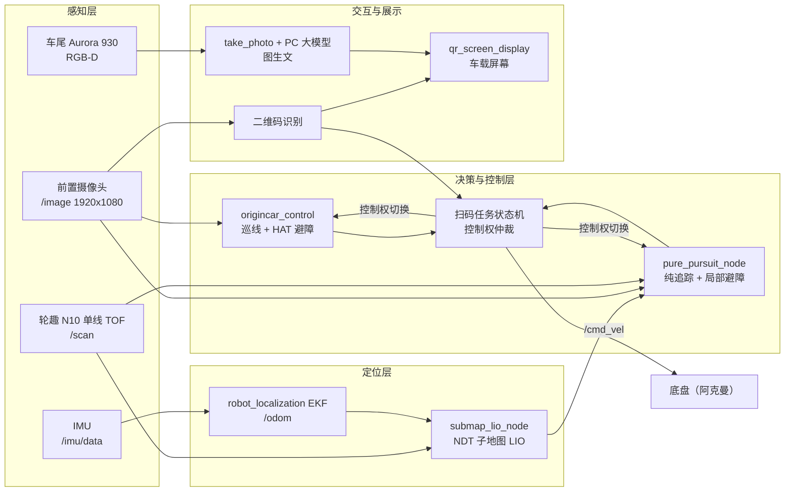

# 【团队赛后总结报告】睿行·DoveSmart — 全国大学生智能汽车竞赛（地瓜机器人智慧医疗赛项）

## 基本信息

| 项目 | 内容 |
| --- | --- |
| 比赛日期 | 2025-2026赛季 |
| 比赛名称 | 全国大学生智能汽车竞赛 |
| 赛项名称 | 地瓜机器人智慧医疗赛项 |
| 队伍编号 | 一队 |
| 队伍名称 | 睿行·DoveSmart（同济大学，队长：孙智诚） |
| 提交日期 | 2026-09-16 |
| 参赛平台 | RDK X5 主控 + TROS / ROS 2 Humble，全自动模式 |

---

## 1. 最终系统概述

### 1.1 完整系统方案

最终版本是一套视觉感知 + 激光/惯性融合定位 + 分阶段运动控制 + 车端/PC 协同推理
的全自动方案，按赛题的四项子任务组织运行：

1. **自主前往任务发布点** —— 前置摄像头巡线，`origincar_control` 依据视觉检测结果完成
   巡线、转向与动态避障；
2. **任务信息获取与展示** —— 前置摄像头图像经二维码节点解码，得到四位数字与由此确定的
   顺/逆时针方向；车辆在任务发布区以倒车姿态使车尾 Aurora 930 对准图文标记牌取景；
3. **黄色通道任务** —— 扫码并停稳后，底盘控制权由视觉巡线模块移交给 LIO 控制器，
   按二维码结果选择顺时针/逆时针预设路线，结合实时定位与局部避障完成通道内行驶；
4. **自主返回停车点** —— 继续路径跟踪与避障，引导车辆返回 P 点并在终点区域停车。

整体流程：

```text
启动与 IMU 静态校准 → 前视巡线/避障 → 二维码识别与方向判定 → 停车并切换控制器
→ 倒车取景与图生文 → 按指定方向通过黄色通道 → 返回 P 点 → 屏幕显示任务结果
```

模块划分（`src/` 下 31 个 ROS 2 功能包；自研与移植源码合计约 4.8 万行，不含厂商预编译库
`ext/` 目录）：

| 层 | 功能包 | 职责 |
| --- | --- | --- |
| 底盘与状态估计 | `origincar_base` / `base_orin` | 串口底盘通信、轮速里程计、IMU 发布；`robot_localization` EKF 输出 `/odom`（`odom → base_footprint`） |
| 第一赛段视觉 | `origincar_control`、`image_binary`、`image_bridge`、`image_bridge_hsv` | 巡线、HAT 障碍物绕行、二维码对准；HSV / Lab 二值化与图像桥接 |
| 二维码 | `qr_code_detection`、`zxing_qr_code_detection`、`qr_code` | YOLO + WeChatQRCode 解码；ZXing-C++ 备选链路；输出 `/qr_code_result`、`/sign_switch` |
| 定位与导航 | `lio_hybird`（最终基线）、`lio_ob`、`lio_aurora` | `submap_lio_node` 平面 LIO 定位；`pure_pursuit_node` 路径跟踪与局部避障 |
| 激光雷达 | `lslidar_driver`、`lslidar_msgs` | 轮趣 N10 单线 TOF 雷达（`/scan`） |
| 深度相机 | `deptrum-ros-driver-aurora930` | 车尾光鉴 Aurora 930 RGB-D 驱动 |
| 拍照与显示 | `take_photo`、`qr_screen_display` | 路径触发拍照、车端与 PC 图像交换、车载屏幕显示任务结果 |
| 工程辅助 | `teleop_ackermann_joy`、`cmd_vel_publisher`、`listener`、`utils`、`origincar_bringup` | 手柄阿克曼遥控、调试用速度发生器、bringup 汇总 |

数据流（以最终基线 `lio_hybird` 为例）：

```text
/imu/data ------> 平面误差状态预测 -------------------------------+
/odom（轮速） --> 纵向速度观测 -----------------------------------+--> /lio_hybird/odom
/scan -> 去畸变 -> 关键帧 NDT 子地图 -> 迭代位姿更新 -------------+
                         +-> 启动/被拒时回退 scan-to-scan ICP

/lio_hybird/odom + 录制 CSV 路径 -> 曲率受限纯追踪 ---------------+
/win_detection（HAT 检测） ------> 视觉避障策略 ------------------+--> /cmd_vel
/scan --------------------------> 方向性安全走廊 -----------------+
/image_yellow_binary -----------> 环形区视觉轨道护栏 -------------+
```



### 1.2 关键参数 / 性能指标（最终版本）

| 类别 | 参数 | 取值 | 出处 |
| --- | --- | --- | --- |
| 平台 | 主控 / 系统 | RDK X5 / TROS（ROS 2 Humble） | `src/README.md` |
| 感知 | 前置相机分辨率 | 1920 × 1080 | `origincar_control.cpp`、`guandao.yaml` |
| 感知 | 车尾深度相机 | 光鉴 Aurora 930，需 `rgbd_enable:=true align_mode:=true` 同步 RGB-D | `lio_hybird/README.md` |
| 感知 | 激光雷达 | 轮趣 N10 单线 TOF（`sensor_msgs/LaserScan`） | `lio_hybird/README.md` |
| 感知 | 相机-雷达外参 | `base_footprint -> laser = (-0.03, 0.0, 0.23)`，yaw = 0（2026-07-27 实测 TF） | `lio_hybird.yaml` |
| 定位 | EKF 输出频率 | 20 Hz，`two_d_mode: true` | `base_orin/config/ekf.yaml` |
| 定位 | 状态量 | `[x, y, yaw, 纵向速度, 陀螺零偏]`（5 状态平面模型） | `lio_hybird/README.md` |
| 定位 | NDT 关键帧条件 | 位移 0.20 m 或转角 30° | `lio_hybird.yaml` |
| 定位 | NDT 体素 / 最大迭代 | 0.20 m / 20 次 | `lio_hybird.yaml` |
| 控制 | 前向 / 倒车速度上限 | 0.60 m/s / 0.65 m/s（视觉原始目标 0.90 m/s，因实测执行滞后下调） | `lio_hybird.yaml`、`lio_hybird/README.md` |
| 控制 | 扫码后过渡段限速 | 前进 0.28 m/s、倒车 0.28 m/s，直到环形通道入口 | `lio_hybird.yaml` |
| 控制 | 最大角速度 | 2.50 rad/s | `lio_hybird.yaml` |
| 控制 | 避障速度 / 角速度 | 0.45 m/s / 1.80 rad/s | `lio_hybird.yaml` |
| 控制 | 局部推演长度 | 1.80 m；候选轨迹 = 15 个均匀曲率 + 追踪曲率 + 视觉曲率 = 17 条 | `lio_hybird.yaml`、`LOCAL_PLANNER_CORRIDOR_REJECTION_ANALYSIS_20260807.md` |
| 控制 | 路径走廊半宽 | 首选 0.32 m；紧急 1.05 m | `lio_hybird.yaml` |
| 控制 | 巡线比例增益 | `xunxian_k = 0.0016`，画面中心 `REAL_MIDX = 920` | `origincar_control.cpp` |
| 控制 | HAT 避障触发 | 包围框高度比 0.22（强制 0.50），目标像素偏移 1.60 × 帽宽 | `origincar_control.cpp` |
| 定位/地图 | 场地坐标系 | 5 m × 5 m，原点在场地下左角，`+x` 右、`+y` 上，yaw 0 | `lio_hybird/README.md` |
| 定位/地图 | 语义禁行区掩码 | 1024 × 1024 图按 0.0048828125 m/像素解释，白区可行驶、黑区禁行 | `lio_hybird.yaml` |
| 路线 | 理想赛道路径 | 200 点/份；第 72 点为中间通道/环形区交接点 | `STAGE_HANDOFF_20260806.md` |
| 交互 | 图生文通信 | ZMQ REQ/REP，`tcp://<PC_IP>:5555`，512 × 512 / JPEG 质量 60 | `rdk_client_test_0.4.py`、`qr_screen_display/README.md` |

### 1.3 特色 / 创新点

1. **车端与 PC 协同的大模型图生文**：车端只负责取景、方向校正（车尾 Aurora 图像旋转 180°）、
   缩放与 JPEG 编码，通过 ZMQ 把图像交给本地电脑上的视觉大模型，再由 PC 回传中文描述。
   网络通信与推理放在独立线程，不阻塞定位与运动控制。
2. **显式的控制权仲裁机制**：两个控制器（视觉巡线、LIO 路径跟踪）共用 `/cmd_vel`，
   但通过扫码状态机保证同一时刻只有一个发布运动指令 —— 扫码瞬间统一制动，等底盘
   实测速度低于 0.04 m/s 后所有权**永久**移交给 LIO 控制器，避免两个程序抢底盘。
3. **自研的平面 NDT 子地图 LIO**：不依赖 Nav2 AMCL 与全局栅格地图，用「轮速/IMU 预测 +
   激光逐点去畸变 + 关键帧体素子地图 NDT」实现场地坐标系定位，用持久子地图匹配代替
   「只对上一帧累积」，并保留 scan-to-scan ICP 作为启动兜底。
4. **视觉主导、雷达否决的避障分工**：视觉一旦给出有效 HAT 目标就掌握绕行侧决策，
   雷达只负责否决会碰撞的轨迹，而不是替代相机的转向策略；同时用「确认式障碍点记忆」
   与 PCA 长直簇抑制处理稀疏反射点与纸墙。
5. **带明确方向语义的录制路径**：路径 CSV 第八列显式标注行进方向（1 前进 / -1 倒车），
   换向点被定义为不可跨越的硬 cusp，控制器在换向前按速度相关制动距离锁存停车。

---

## 2. 备赛历程回顾（按时间线 / 版本线）

> 时间线依据机器人 `log/build_*` 目录名（colcon 每次构建或运行都会留下带时间戳的目录）、
> `tmp/qr_crop_*` 现场截图文件名以及工作区内带日期的开发文档整理。
>
> 另外，`log/` 里还留有 `2025-07-27` 至 `2025-08-03` 以及 `2025-01-13` 的一批构建记录
> （同族巡线包的早期形态，`origincar_control.cpp` 的文件头也写着 `//2025-8-2`）。
> 本报告的时间线只覆盖 2026 年春季学期的备赛期。

### 2.1 重大迭代节点

| 版本 | 时间窗 | 动因 | 主要改动 | 可核对的证据 |
| --- | --- | --- | --- | --- |
| V0.1 底盘可用 | 2026-03-27 ~ 03-29 | 先把底盘、EKF、串口链路跑通 | `cure_line` 巡线包与 `image_bridge` 首次上车调试 | 该阶段 29 次构建（27 次非空）：`cure_line` 26 次、`image_bridge` 1 次 |
| V0.2 巡线与分段 | 2026-04-02 ~ 04-25 | 单一巡线在赛道分段（第二赛段）识别不稳 | 拆出 `second_line` 做分段巡线，并加入 `cmd_vel_publisher`、`listener` 做速度与话题隔离测试 | 该阶段 123 次构建（122 次非空）：`cure_line` 99 次、`second_line` 18 次、`cmd_vel_publisher` 与 `listener` 各 3 次、`origincar_bringup` 2 次 |
| V0.3 巡线打磨与拍照 | 2026-05-01 ~ 05-29 | 需要把巡线调到能在完整赛道上稳定通过，并在任务区取景 | 新增 `take_photo`；`origincar_bringup` 汇总 launch；`cure_line` 进入高频调参期 | 该阶段 139 次构建：`cure_line` 124 次、`take_photo` 6 次、`second_line` 5 次、`origincar_bringup` 4 次；`tmp/qr_crop_20260529_*` 共 1197 张现场截图 |
| V0.4 统一控制节点 | 2026-06-04 ~ 06-05 | 多个控制包参数不同步，现场改参数要重编多次 | 合并为单一 `origincar_control`（巡线 + HAT 避障 + 二维码对准 + 控制权释放），保留 `only_second_line` 作对照 | 06-05 构建记录：`origincar_control`、`only_second_line` |
| V1.0 LIO 接管下半场 | 2026-08-03 ~ 08-08 | 纯视觉在黄色通道与环形区没有米制位姿，无法稳定按顺/逆时针走环 | 引入 `base_orin`（EKF 底盘）与 `guandao`（无雷达录径控制器），随后落地 `lio_hybird`（NDT LIO + 纯追踪）、`image_binary` / `image_bridge_hsv`（黄色通道二值化）、`qr_code_detection`（YOLO + WeChatQRCode） | 08-03 `base_orin`、`guandao`；08-08 `lio_hybird,origincar_control,qr_code_detection`；08-08 一天 17 次构建 |
| V2.0 扫码后路线族 | 2026-08-11 ~ 08-12 | 扫码后位姿与旧路径初始航向差约 150°，控制器出现长距离倒车与反复重试 | 重新设计「扫码后固定路径」：`parking`（倒车揉库基线）、`right_turn`（全前进右后调头对照）；新增 ZXing-C++ 二维码链路 `zxing_qr_code_detection`；拆出 `lio_aurora` 实验包 | 08-11 构建 `zxing_qr_code_detection`、`qr_screen_display`；08-12 构建 `lio_aurora`、`lio_hybird` |
| V3.0 倒车直入环与环形视觉纠偏 | 2026-08-13 ~ 08-16 | 环形区上位姿漂移，以及探索「直接倒车穿中间通道」 | `reverse_ring*` / `reverse_full_ring*` / `symmetry` 路线族；环形区用黄色二值图 + Aurora 深度反投影做米制横向与航向观测并校正 LIO；拆出 `lio_ob` 实验包 | 08-13 ~ 08-16 共 14 次构建：`lio_hybird` 11 次、`qr_screen_display` 2 次、`lio_ob` 1 次；`lio_hybird/README.md` 中 `reverse_ring`、`ring_y_correction` 等参数；`paths/` 下 20 余份路线与预览图 |

**量化对比（同一天、同一条第一赛段）**：2026-08-11 现场录包 `records/pre_qr_pid_run_01~03`
中，`run_03` 完整跑完第一赛段并成功扫码：

- 第一赛段有效时长 **4.545 s**；
- 起终点（场地位姿）：从 `(0.540, 0.300, yaw 约 0)` 到 `(3.351, 0.917, yaw 约 0.569 rad)`；
- 扫码判定：`origincar_control` 记录 `sign_data=4`（逆时针），随后停止图像订阅并发布
  `control_released`，完成控制权移交；
- 该段共解析出 73 条 PID 记录、723 条控制器事件日志。

> 需要注意（这是当时踩过的判断坑）：日志里 PID 的**更新频率不是恒定值**，平均约
> **15.88 Hz**，间隔范围 0.030 ~ 0.857 s。正常巡线用的其实是直接比例控制
> `angular.z = -(line_x - REAL_MIDX) × xunxian_k`，PID 只用于视觉避障与二维码对准，
> 所以 PID 样本之间的长空档代表控制模式切换，不是丢数据。做数值微分必须用实际 dt。

### 2.2 放弃的方案与原因

**（1）Nav2 / TEB 局部规划接管 —— 已彻底移除**

最初的做法是：固定路径被障碍物挡住时，把剩余路径截出来交给 Nav2 `controller_server`
里的 TEB 控制器做局部优化。深入做了 TEB 参数、滚动局部代价地图、生命周期管理与
重试机制之后放弃，理由是：

- 它在扫码位姿与旧路径初始航向差约 150°、且前进偏好权重只有约 0.4 时，**判定「倒车比
  原地大角度转向更便宜」**，于是从 `(3.59, 1.36)` 一路倒到 `(3.56, 0.40)`，随后
  `Failed to make progress` 反复重试；暴露的是代价函数与路径设计的不匹配，
  而不是某个开关没开。
- 高频超时进一步拖慢 LIO，造成扫描队列满、代价地图丢弃过期扫描。
- 系统里只起了 `controller_server` + 滚动代价地图 + lifecycle manager，**没有 AMCL、
  没有 map server、没有全局规划器、没有行为树**，本质上不是完整 Navigation2，
  却引入了完整的 Nav2 调试面。

最终决策：**完全删掉 Nav2 / TEB**，由内置纯追踪与局部避障负责包括扫码后通道段、
所有前进/倒车方向切换在内的每一段路径。`STAGE_HANDOFF_20260806.md` 开头即声明
TEB 内容「仅保留作历史背景，不代表当前可用启动方式」。

**（2）`guandao`：无雷达的纯录径控制器 —— 保留但未作最终基线**

2026-08-03 曾实现一个独立、不依赖雷达、不使用激光做碰撞检查的录径控制器
（`/odom_combined` + 纯追踪 `->` `/cmd_vel`，只靠视觉 HAT 减速绕行）。它的价值在于
把「定位问题」和「避障问题」解耦，用于验证路径本身是否可跑。不作为主线的理由是：
黄色通道与环形区存在真实锥桶与纸墙，只靠前视视觉无法保证车体矩形包络不撞；
最终保留为可切换的对照实现。

**（3）`right_turn`：全前进向右后方调头 —— 保留为 A/B 对照，未作基线**

前 72 点全部前进、以约 0.40 m 半径向右后调头。静态几何检查（30 cm × 20 cm 车体外框）
没有进入黑色禁行区，最小曲率半径约 0.399 m，但它「更依赖可用空间、定位精度、转向响应
和避障器的连续可行解」。与之对照的 `parking`（前进→倒车→前进揉库）最小曲率半径约
0.451 m，在既有真车数据下成功概率更高，因此把 `parking` 定为基线。

**（4）早期视觉巡线的多套分支 —— 收敛到 `origincar_control`**

与第一赛段控制同族的包还有 `cure_line`（Lab 色彩空间找黄/绿边界）、`second_line`、
`only_second_line`、`fast_second`、`slow_control`、`kevin_control` 与 `boundary_line`
（`boundary_line` 只留下 `build/`、`install/` 产物，没有对应的构建日志）。
从构建日志看，2026 年备赛期内真正反复迭代的只有 `cure_line`（249 次）与
`second_line`（23 次），`only_second_line` 与 `kevin_control` 各只构建过 1 次；
`fast_second` 与 `slow_control` 只出现在 2025 年那一批日志里。放弃继续维护多套分支的
原因是：参数分散在不同包里，现场改一个阈值要重新编译多个包；而且「某套更好」的
体感判断无法与路径问题、定位问题区分开。收敛成单一 `origincar_control` 之后，
第一赛段的所有调试都在一个节点、一套参数里完成。

---

## 3. 关键技术决策详解

### 3.1 决策 1：算力与分工 —— RDK X5 车端 + 本地电脑协同推理

**决策背景**：赛题要求车端把图文标记牌的内容转成文字并显示在车载屏幕上，而车端算力
还要同时承担巡线、二维码解码、LIO 定位与路径跟踪。

**考虑的方案**：

- 全部推理放在车端 RDK X5 的 BPU 上（`config/` 下预留了 yolo v2 / v3 / v5x / v8 /
  v8seg / v10、fcos、fcosb3、mobilenet_ssd、efficientnet_lite0、stdc、mobilenet_unet 等
  一批 workconfig）；
- 全部放到 PC，车端只做透传；
- 车端做视觉前端 + PC 做大模型图生文。

**评估维度**：实时性与对控制环的干扰、可维护性（现场能否快速换模型）、
网络依赖（赛场网络是否稳定）、开发时间。

**最终选择与理由**：采用第三条。车端保留 YOLO（`pro_03.bin`，4 类：`P` / `code` /
`hat` / `line`）做实时检测，把需要大模型的重活交给 PC：车端 `ring_photo_client`
取最近一帧、把车尾 Aurora 图像旋转 180°、缩放到 512 × 512 并按 JPEG 质量 60 编码，
走 ZMQ `tcp://<PC_IP>:5555` 发给 PC，再把返回的中文文本发布到 `/take_photo/result`。
上传与轮询都在独立线程里做，带重试与退避（上传 10 次重试、结果轮询 180 次、
初始延迟 4 s、轮询间隔按 1 s 逐步放大到 5 s），**任何网络异常都不会阻塞定位与运动控制**。

**回头看**：这个拆分方向是对的，它把「网络抖动」变成了一个可观测、可重试的模块，
而不是让控制环跟着抖。会调整的地方是：把「上传失败」与「推理超时」明确区分成两个
状态并在 `/take_photo/status` 上给出告警位，而不是让上位机统一等到超时；
另外把图片尺寸与 JPEG 质量做成 launch 参数（目前是代码内默认值），
现场调网络预算时会更快。

*[主导人：孙智诚]*

### 3.2 决策 2：第一赛段的控制归属 —— 私有话题 + 一次性制动 + 永久移交

**决策背景**：第一赛段必须视觉巡线（要有画面才能绕 HAT 障碍），第三、四赛段必须有
米制位姿（要按顺/逆时针走环）。两个控制器不可能同时跑在同一段赛道上，
但也不适合在扫码瞬间边跑边切。

**考虑的方案**：

- 让 `origincar_control` 把速度直接发到 `/cmd_vel`，扫码后 LIO 再接管
  （**两个发布者共存**，靠时序赌不冲突）；
- 用定时器做一段命令重放/转发过渡，把视觉指令以固定频率转发给 LIO 控制器；
- 视觉控制器改发**私有话题**，由主控制器在自己拥有控制权时转发；扫码即统一制动，
  等底盘实测速度降下来再一次性移交。

**评估维度**：安全性（是否会两个节点抢底盘）、可观测性、切换延迟、代码耦合。

**最终选择与理由**：采用第三条，并在实现上收紧成一个状态机：

1. 扫码前：独立的 `origincar_control` 直接发 `/cmd_vel`；LIO 只定位、只发诊断，不发速度；
2. 收到有效 `/sign_switch`：`origincar_control` 立即停掉图像订阅、发一次零速，并
   ack `/origincar_control/control_released`；若第一赛段由 LIO 接管，则视觉控制器的速度
   发到私有话题 `/lio_hybird/visual_first_line_cmd`，由主控制器在拥有控制权时转发；
3. 底盘 `/odom` 实测速度低于 **0.04 m/s** 后，所有权**永久**交给
   `lio_hybird_controller`，由它直接发 `/cmd_vel`；
4. 移交后 HSV 桥接才开始处理环形图像（在此之前保持空闲，省 CPU）。

**回头看**：这是整个系统里最值得保留的决策。它把「抢底盘」从时序问题变成了状态问题 ——
两个节点谁在发速度是可以从 `/lio_hybird/state` 读出来的，而不是靠推断。遗留问题是
「永久移交」意味着一旦移交就不能自动退回视觉控制；如果将来要做多次任务发布点，
需要改成显式的双向移交。另外必须保留的一条纪律：**绝不能同时启动 Nav2
`controller_server` 或 `dzfollowpath`**，否则会多出一条竞争的命令通路。

*[主导人：孙智诚]*

### 3.3 决策 3：定位方案 —— 自研平面 NDT 子地图 LIO，而不是 Nav2 AMCL

**决策背景**：黄色通道与环形区需要连续的米制位姿，赛道两侧是长条纸墙，
而激光雷达是单线 TOF（轮趣 N10，只输出 2D `LaserScan`）。

**考虑的方案**：

- Nav2 AMCL + 全局栅格地图；
- 累积式 ICP（只对上一帧做点到线匹配）；
- 3D 点云 + 增量 NDT + ESKF/IESKF 的参考实现；
- **2D 等效的 NDT 子地图 + 五状态平面 EKF**。

**评估维度**：可用传感器、计算量与实时性、长时间运行的漂移、
与自研控制器的接口成本。

**最终选择与理由**：

- 参考方案是 3D 点云 + 增量 NDT + ESKF/IESKF，但本车雷达只输出 2D `LaserScan`，
  于是实现 **SE(2) 等效版本**：由轮速/IMU 做运动预测并对扫描去畸变，扫描按
  **0.20 m 或 30°** 插入关键帧，当前帧与最近的关键帧体素子地图做迭代 NDT 匹配；
  点到线 ICP **仅用于启动阶段或 NDT 更新被拒时兜底**。
- EKF 状态取 `[x, y, yaw, 纵向速度, 陀螺零偏]`，**故意不做 3D**：没有 z / roll / pitch 状态，
  也不做加速度计位置积分 —— 廉价 20 Hz IMU 加轮速更适合五状态平面模型。
- **只用轮速的实测纵向速度，不用轮速积分出来的位姿**，避免把同一个轮式积分位姿
  两次喂进滤波器。
- **默认不融合 IMU 的朝向四元数**：车上 Madgwick 滤波设了 `use_mag=false`，
  它给出的 yaw 本质是同一路陀螺的另一次积分，当成独立绝对观测会造成双重计数、
  让 yaw 协方差虚假收敛。角速度与静止零偏估计负责预测，NDT 才是独立的 yaw 修正；
  `use_imu_orientation` 只为将来「有真正独立航向参考的 IMU」保留。
- `publish_tf` 默认 **false**：`base_orin` 的 EKF 已经在发 `odom -> base_footprint`，
  再发一条 `lio_hybird_odom -> base_footprint` 会让同一个子坐标系出现两个父节点。
  控制器直接消费 `/lio_hybird/odom`，因此不影响控制。

**回头看**：把架构实验（用持久子地图匹配替代只对上一帧累积）作为主线是对的，
它让纸墙这类长条特征从干扰变成了有用信息。如果有机会重来，会**更早**做两件事：
一是把 `base_footprint -> laser` 外参实测（目前是 2026-07-27 才测得
`(-0.03, 0.0, 0.23)`、yaw 0）提前到系统联调第一天；二是更早把「定位是否退化」
做成可观测指标 —— 节点已经每 5 s 打印累计 NDT 接受率、ICP 回退次数、拒绝次数与
扫描匹配耗时，但这些数字应该从第一天就接进 RViz 面板，而不是只留在终端。

*[主导人：孙智诚]*

### 3.4 决策 4：局部避障 —— 视觉定侧、雷达否决、固定曲率模板 + 走廊硬约束

**决策背景**：HAT 帽障碍物需要绕行，但单线 TOF 雷达有盲区，也会被纸墙与稀疏反射点污染。

**考虑的方案**：

- 纯视觉避障（便宜，但无法保证车体包络）；
- 纯雷达避障（可靠，但会把长纸墙当成障碍）；
- 视觉掌握绕行侧决策、雷达只做碰撞否决；
- 自由空间采样式规划（任意折线、任意终点）。

**评估维度**：实时性、可解释性、安全边界，以及出现「看起来有路但规划器说没路」时的
排查成本。

**最终选择与理由**：第三条为主，配合有限的模板采样。具体地：

- 触发与目标像素策略**直接从已跑通的 `origincar_control.cpp` 抽取**：正常触发在
  包围框高度比 0.22、强制触发 0.50，避障目标像素 = 帽中心 + 1.60 × 侧别 × 帽宽；
- 每条候选轨迹是一条空间 S 形：先向选定自由侧转出、保持横向偏移、再用反向曲率回到
  与记录路径平行；用**完整矩形车体包络**对去畸变激光点做碰撞检查；
- 障碍点先过滤再进记忆：必须先在相邻激光束上聚成 3 点簇，再在 0.30 s 与 0.10 m 内
  获得第二次观测；未确认的候选 0.35 s 后过期且**永不参与碰撞检查** ——
  防止瞬时亮点被「晋升」为持久静态障碍；
- 纸墙额外按形状拒绝：连续束分组后做 PCA，剔除「长度 ≥ 0.45 m、点数 ≥ 8、细长、
  强线性」的簇；紧凑的锥桶簇保留。**注意这个滤波不改 `/scan`，也不影响 LIO 用的点** ——
  长纸墙对定位是有用特征；
- 5 m × 5 m 外圈纸墙是已知场界，0.20 m 周界带内的回波从锥桶点云里滤掉，
  由米制场界与语义掩码防止车体越界；
- 局部规划器**只生成固定三段曲率轮廓**（前 40% 转出、中 20% 直行、后 40% 转回），
  当前参数下共 15 个均匀曲率 + 1 个追踪曲率 + 1 个视觉曲率 = **17 条轨迹**。

**2026-08-07 的失败与结论（重要）**：一次停车的原因是
`拒绝统计[角速度=0 路径指标=0 路径走廊=17 禁行区=0 碰撞=0]` —— 17 条轨迹
**全部在「路径走廊」硬约束处被拒**，而不是雷达认为四面都会撞。根因是：

- `parking` 路线（顺/逆时针开头相同）点 1 到点 4 的同方向前进段只有约 **0.116 m**，
  点 5 立即切倒车；
- 局部规划器仍要求每条前进轨迹**完整推演 1.80 m**，且全程不得离参考路径超过
  `emergency_path_half_width = 1.05 m`；
- 路径搜索又禁止跨越前进到倒车的换向点，所以前进轨迹只能参考这 4 个点。

结论：这是**「自由空间存在，但当前轨迹模型与走廊约束无法表达这条通路」**，
不是雷达故障，也不是角速度、禁行区或碰撞检查的问题。日志里「候选点=30」这个名字
也误导过我们 —— 它打印的是 `laser_points_.size()`，是参与计算的 30 个激光障碍点，
不是 30 条候选路径。修正方向定为：为「短同方向段与换向点」设计专门策略
（安全制动 + 判断能否提前进入路线本就计划的倒车段），**而不是先放宽碰撞半径或软代价
权重** —— 权重只作用于已经通过硬检查的轨迹。

**回头看**：视觉定侧、雷达否决的分工是有效的，而且「拒绝原因计数按第一个失败原因
累加」这个设计极大缩短了这次排查时间。真正该改的是**轨迹模板的自由度**：
固定 S 形轮廓在短方向段与换向点附近是结构性不足。如果重来，会先让规划器能表达
「原地不动 / 提前换向 / 短距离动作」，再去调参数。

*[主导人：孙智诚]*

### 3.5 决策 5：扫码后路线族 —— 揉库基线 + 明确的方向硬换向点

**决策背景**：车在任务发布区以**倒车姿态**用尾部相机取景，因此扫码完成时车头方向
与「进入中间通道」的方向常常相差很大。

**考虑的方案**：

- `parking`：前进 -> 倒车 -> 前进揉库，保留明确的换向过程；
- `right_turn`：全前进右后调头；
- `reverse_ring`：从 `(4.20, 1.50, 30.2°)` 直接倒车穿中间通道，在环形下侧左段
  （约 `(1.75, 3.20, 0°)`）切换为前进，再复用原环形路线；
- `reverse_full_ring` / `reverse_full_real_ring` / `symmetry` 等变体。

**评估维度**：接入位姿容差、最小曲率半径、车体包络是否进黑区、成功概率，
以及对避障器是否有连续可行解的要求。

**最终选择与理由**：

- 把 `parking` 定为基线：最小曲率半径约 0.451 m，以 30 cm × 20 cm 车体外框做离线
  几何检查，前 72 点未进入黑色禁行区，且有真车数据支持「成功概率更高」。
- 把方向定义为**硬 cusp**：路径 CSV 第八列显式给出行进方向，追踪与进度搜索
  **不能跨越换向点**，控制器在换向前按速度相关制动距离锁存停车 ——
  越过了位置容差也不会误把旧方向重新打开。
- 对 `reverse_ring` 系只做逆时针（`sign_data=4`）的版本；扫码结果是顺时针
  （`sign_data=3`）时不擅自镜像，而是回退到 `parking` 的顺时针路径。
- 扫码后到通道入口之间独立限速（前进与倒车均 0.28 m/s，直到
  `post_qr_transition_end_y = 1.90`），之后才套用全局速度上限。

**回头看**：把「扫码后怎么走」当成一个**路线族 + 显式方向语义**来处理，而不是让控制器
现场生成连接段，这个决策是对的 —— 它让每次路线改动都能用离线几何脚本先验证
（`scripts/generate_qr_split_paths.py` 与 `paths/*.png` 预览），上车前就能筛掉明显
不可行的几何。代价是路径文件数量膨胀到 20 余份，维护成本高；下次应同时维护一份
「路线清单 + 选用条件」的表格，避免现场靠记忆去选 `post_qr_route_mode` 参数。

*[主导人：孙智诚]*

---

## 4. 赛场表现分析


### 4.1 比赛中系统的实际表现（成功 / 失误 / 意外）

这个和4.2一起说。

### 4.2 赛场突发技术问题的应急处理

前往比赛场地的过程中，由于路途遥远，车辆发生了一定程度的颠簸，导致stm32和rdk x5的通信不畅。这个问题直接导致我们试车时原代码无法正常工作，是很严重的恶性事故。不过由于我们有2队，在场边我们调试正常后，下午使用2队的试车时间确认imu等部件已恢复正常。

比赛过程中，由于今年的局部规划器写得很仓促，加之赛场障碍物摆放方式没有测试过，在中途发生了规划器长时间死锁的情况，不过最后死锁解除，成功完赛。

二维码的现场摆放也与规则不同，实际摆放均朝y轴负方向（这个xy是以我们代码里的方向来讲的），并非规则与赛前会中所说的沿对角线方向。最终origincar control视觉方案多次失效，我们临场决定换用不太成熟的纯lio方案，跑完了第一条线。

### 4.3 赛后复盘：哪些准备不足，哪些超出预期

**准备不足**

1. **版本管理几乎为空**。整个工作区的 git 仓库到赛后仍处于「main 分支没有任何提交」的
   状态，`build/`、`install/`、`log/`、`src/`、`config/`、`records/` 全部是未跟踪文件；
   交接文档里也明确写着 `src/origincar/lio_ob/`「尚未被 Git 跟踪，不要期望通过提交历史
   恢复」。这意味着最关键的算法演进没有任何可回滚的基线，只能依赖目录里的文档与
   `log/build_*` 时间戳反推。
2. **参数与代码耦合偏高**。第一赛段要改一个阈值就得重新编译整个包；`install/` 与源码
   不同步时会出现「改了参数但跑到旧二进制」的经典问题，文档里多次强调「必须重新构建
   并重新 `source install/setup.bash`」。
3. **对「规划器说没路」的可观测性不足**。8 月 7 日那次停车，日志只给出拒绝原因计数，
   缺少「当前路径点、同方向段终点、同方向剩余弧长、本轮走廊半宽、每条失败轨迹首次
   越界的推演距离」这些关键上下文，导致根因要靠事后读代码推断。
4. **调试数据缺乏统一归档**。`tmp/` 下累积了 5613 张 `qr_crop_*` 现场截图
   （2026-05-29、08-05、08-07 至 08-14 等多天），当时没有按「日期 / 场地 / 参数版本」
   建立索引，事后很难把某张图对应回当时的参数。
5. 局部规划器的编写仍然有比较大的缺陷，尤其是决策的速度、质量、稳定性，这些很影响小车在实际场地上的表现。

**超出预期（有证据的部分）**

1. **控制权仲裁一次成功**：从录包看，扫码瞬间制动、等底盘速度降到 0.04 m/s 以下再移交的
   过程干净，没有出现两个控制器同时发 `/cmd_vel` 的抢底盘现象。
2. **视觉第一赛段的完成时间**：2026-08-11 排练中 `run_03` 的第一赛段有效时长只有
   **4.545 s**，并成功扫码（`sign_data=4`），说明在难度最高的「巡线 + 避障 + 对准二维码」
   组合段上，系统已经在排练里具备完整闭环能力。
3. **障碍点过滤链**：单线 TOF 的盲区与稀疏反射点原本是硬伤，
   「三点点簇 + 二次观测确认 + 0.30 s / 0.10 m 关联 + PCA 长直簇剔除 + 0.20 m 周界带」
   这一套组合滤波把纸墙与亮点基本清理干净，且没有牺牲 LIO 使用的原始扫描。

---

## 5. 工程传承建议

### 5.1 技术遗产（可复用的代码库 / 模块 / 脚本 / 数据）

**（1）代码与模块（均在工作区 `src/` 下）**

| 资产 | 路径 | 复用价值 |
| --- | --- | --- |
| 平面 NDT 子地图 LIO | `src/origincar/lio_hybird/src/submap_lio_node.cpp`（约 6.5 万字节） | 单线 TOF + 轮速 + IMU 的场地级定位，可直接移植到任何 5 m 级室内场地 |
| 纯追踪 + 局部避障 + 脱困状态机 | `src/origincar/lio_hybird/src/pure_pursuit_node.cpp`（约 20.8 万字节） | 曲率受限追踪、方向硬换向、避障采样器、`ESCAPE_*` 脱困、语义掩码护栏 |
| 第一赛段视觉控制 | `src/origincar/origincar_control/src/origincar_control.cpp` | 巡线比例控制、HAT 触发与目标像素策略、二维码对准、控制权释放协议 |
| 二维码链路（主备两套） | `src/origincar/qr_code_detection/`（YOLO + WeChatQRCode）、`src/origincar/zxing_qr_code_detection/`（ZXing-C++） | 主备双路，输出 `/qr_code_result` 与 `/sign_switch` 语义一致 |
| 黄色通道二值化 | `src/origincar/image_binary/`、`src/origincar/image_bridge_hsv/` | 注意力区域 ROI 与 (H,S,V) 阈值、形态学参数全部集中在文件头部「调试参数集中定义区域」，可直接改 |
| 路径生成与预览脚本 | `src/origincar/lio_hybird/scripts/`：`generate_qr_split_paths.py`、`generate_racing_line.py`、`generate_real_reverse_full_ring_*.py` | 全部离线可跑，生成 CSV 路径与 PNG 预览，上车前即可做几何筛选 |
| 录包导出脚本 | `src/origincar/lio_hybird/scripts/export_pre_qr_pid_csv.py` | 把 rosbag 与终端日志合并成「PID 对齐 CSV」，是复盘第一赛段的标准工具 |
| 无雷达对照控制器 | `src/guandao/` | 需要单独验证「路径本身是否可跑」时，可以把定位与避障解耦 |
| 车端与 PC 图生文客户端 | `rdk_client_test_0.4.py`、`src/origincar/qr_screen_display/` | ZMQ 上传 + 轮询 + 重试的完整实现，含车尾图像 180° 校正 |

**（2）文档**

- `src/README.md`：赛前备案的整体方案（赛项、平台、四项子任务、技术方案概述）。
- `src/origincar/lio_hybird/README.md`（约 26 KB）：定位与控制的数据流、控制权归属、
  避障与滤波策略、环形区纠偏、构建与启动命令、RViz 图例、校验顺序。
- `src/origincar/lio_hybird/STAGE_HANDOFF_20260806.md`：阶段交接文档，含「代码边界与
  版本状态」「已知失败与根因」「启动后必须核对」「真车录包模板」「推荐调试顺序」
  「后续开发优先级」「修改时不要破坏的约束」。
- `src/origincar/lio_hybird/LOCAL_PLANNER_CORRIDOR_REJECTION_ANALYSIS_20260807.md`：
  一次真实停车的完整根因分析，写到代码行号级依据。**这份故障复盘的写法本身就是
  最有价值的传承资产。**
- 逐包 `README.md` / `package.xml`：`guandao`、`zxing_qr_code_detection`、
  `qr_screen_display`、`origincar` 等都写清了各自的话题接口与启动方式。

**（3）数据与配置**

- `records/pre_qr_pid_run_01~03/`：三次第一赛段录包（含 `metadata.yaml` 与 sqlite3
  数据库）；`run_03` 另有 `csv/pid_aligned.csv`（73 行 PID 对齐数据）、
  `csv/origincar_control_events.csv`（723 条控制器事件）与 `note.md` 复盘说明。
- `config/`：RDK X5 BPU 的模型配置（yolo v2/v3/v5x/v8/v8seg/v10、fcos、fcosb3、
  mobilenet_ssd、mobilenet_unet、mobilenetv2、efficientnet_lite0、stdc 等），
  以及实际使用的 `new.json`（4 类模型 `P` / `code` / `hat` / `line`，权重 `pro_03.bin`）。
- `src/origincar/lio_hybird/paths/`：理想赛道路径、赛车线、扫码后路线族与全部几何预览图。
- `teamrx-dovesmart-main/`：队伍的 GitLab 仓库模板（Issue 模板、提交材料清单、
  里程碑规划、命名规范）。

**获取方式**：以上资产都在 `src/`、`config/`、`records/` 三个目录内。机器人的规范路径是
`/userdata/dev_ws`，PC 端通过 SSHFS 挂载为 `/home/saioog/remote_dev_ws`（即本工作区）。
**注意：远程挂载目录不是构建环境，不能在这个挂载盘上执行 `colcon build`**，
编译必须在车端完成。

### 5.2 对下届队伍的技术建议

**必须做**

1. **第一天就建立 Git 基线与提交纪律。** 今年最大的隐患是「没有提交历史」——
   算法演进只能靠文档与日志时间戳还原。每完成一个可跑通的版本就提交一次，
   并给关键实验包（如 `lio_ob`）单独打标签。
2. **先定坐标系，再写控制器。** 场地坐标系锚定在场地下左角、`+x` 右、`+y` 上、yaw 0，
   起步位姿 `(0.54, 0.30, yaw 0)`；录制路径、禁行区掩码、`align_path_to_start` 开关
   全部围绕这一条约定。越早统一越省事。
3. **实测执行链滞后并写进参数。** 文档里的结论很具体：原始视觉控制器目标速度是
   0.90 m/s，但 2026-07-28 的录包测出「从 yaw 指令到 IMU 响应约 0.75 s」、
   「0.5 m/s 停车约需 1.5 s」，据此才把前向上限压到 0.60 m/s，并把
   `obstacle_reaction_time = 0.75` 写进避障。**不要用设计值代替实测值。**
4. **每次改路径、参数或规划器后按固定模板录包。** 推荐话题集合见
   `STAGE_HANDOFF_20260806.md` 第 10 节（`/lio_hybird/odom`、`/odom`、`/imu/data`、
   `/scan`、`/cmd_vel`、`/sign_switch`、`/lio_hybird/state`、`/lio_hybird/tracking_path`、
   `/lio_hybird/lookahead`、`/lio_hybird/local_plan`、`/lio_hybird/obstacles`、
   `/local_plan`、`/local_costmap/costmap`、`/tf`、`/tf_static`），并同步录一段能看见
   场地边界与车姿的视频，记录障碍物摆位与人工干预时刻。
5. **一次只改一组参数**，并按「静止查频率与 TF -> 无障碍低速 -> 恢复比赛速度 ->
   放单个障碍 -> 复现 abort -> 最后才测环形区与多个障碍」的顺序隔离问题。

**不要做**

1. **不要同时运行两套速度控制器**（另一套 Nav2 `controller_server`、`dzfollowpath`
   或任何第二个 `/cmd_vel` 发布者）。今年 TEB 方案被移除的直接教训就在这里。
2. **不要把 `install/` 当成修改来源。** 改源码后必须在车端重新构建并重新
   `source install/setup.bash`，否则很容易运行到旧的 install 内容。
3. **不要用 RViz 里的车框是否移动来判断定位是否停住。** 车框标记由纯追踪发速度时刷新，
   接管后纯追踪不发速度，标记会「看起来冻结」，但 `/lio_hybird/odom` 仍在更新。
   判断定位要看 `ros2 topic hz /lio_hybird/odom` 与 `ros2 topic echo /lio_hybird/odom --once`。
4. **不要为了「看起来有路」就放宽碰撞半径或关掉碰撞检查。** 照片上的空地是人眼判断，
   控制器还要面对定位误差、车体包络、转向滞后与雷达盲区。
5. **不要让规划器跨越前进与倒车的换向点**，也不要在固定路径畅通时让局部规划器接管。

**可选探索**

1. 让局部规划器能表达「原地不动 / 提前换向 / 短距离动作」，而不是只有固定 S 形三段曲率 ——
   这直接对应 8 月 7 日那次「17 条轨迹全被走廊拒绝」的结构性原因。
2. 把环形区的「黄色二值图 + 深度反投影 + 车道中心线拟合」观测（当前只在路径点 78 至 86
   附近工作，且需要 5 次一致观测才发一次 `ring_y_correction`）扩展成通用的一维横向护栏，
   用于其他直线段。
3. 用 `enable_speed_weighted_obstacle_memory` 那套「低速扫描更可信」的加权
   （低速权重可从 0.20 连续升到 0.75）替代固定历史融合权重 0.35，在慢速调试场景下更稳。
4. 引入 `/lio_hybird/ring_vision` 那样的**标定通道**（`vector.x` 给 ROS 符号的视觉
   转向误差、`vector.y` 给近场横向偏移、`vector.z` 给 0 到 1 的置信度），
   在正式跑之前先把视觉量纲对齐。

### 5.3 本年度踩过的「坑」（易错点清单）

| 序号 | 现象 | 真实原因 | 应对 |
| --- | --- | --- | --- |
| 1 | 改了参数，真车却没变化 | 跑的是 `install/` 里的旧版本，源码没重编或没重新 source | 改完源码在车端 `colcon build` 后重新 `source install/setup.bash`；用 `ros2 pkg prefix <pkg>` 确认加载路径 |
| 2 | 日志里「候选点=30」被当成「30 条候选路径」 | 代码打印的是 `laser_points_.size()`，即过滤后参与计算的激光障碍点数 | 读日志先对代码，不要按字段名猜语义 |
| 3 | 17 条轨迹全部被拒，怀疑雷达故障 | 是「路径走廊」硬约束：`parking` 开头同方向前进段只有约 0.116 m，而轨迹固定推演 1.80 m 且不得跨换向点 | 先确认「当前路径点 + 同方向剩余弧长」，再改参数 |
| 4 | 导航无解时车辆长距离倒车 | 当前位姿与旧路径初始航向差约 150°，且前进偏好权重只有约 0.4，代价函数判定倒车更便宜 | 重新设计扫码后路径，提高前进偏好，降低规划器计算负担，禁止跨越换向点 |
| 5 | `controller_server` 启动崩溃：`parameter 'height' has invalid type: integer vs double` | 局部代价地图的 `width` / `height` 写成了整数 | 按整数写入；若仍复现，先怀疑 `install/` 里还是旧配置 |
| 6 | 车框在 RViz 里停住，以为定位挂了 | 车框由纯追踪发速度时刷新，接管后不刷新 | 查 `/lio_hybird/odom` 的频率与内容 |
| 7 | 录包里有 PID 记录但没有 PID 数据 | PID 用独立 logger，只输出到终端，不进 `/rosout` | 复盘时把终端日志与 bag 合并导出（`export_pre_qr_pid_csv.py` 已实现） |
| 8 | 按固定周期对 PID 做数值微分，结果很脏 | PID 更新不是恒频：平均约 15.88 Hz，间隔 0.030 ~ 0.857 s；巡线其实用比例控制，PID 只用于避障与扫码对准 | 微分必须用实际 dt；长空档表示模式切换，不是丢数据 |
| 9 | 深度相机的定位门限一直拒绝观测 | Aurora 驱动默认 `rgbd_enable=false`，RGB 与深度时间戳独立 | 启动时显式传 `rgbd_enable:=true align_mode:=true depth_correction:=true` |
| 10 | 二值图颜色和变量名对不上 | `image_binary.cpp` 里 `GREEN_H_*` 实际是黄色阈值（8 至 40）、`YELLOW_H_*` 实际是绿色阈值（90 至 140），注释已说明但变量名会误导 | 改阈值前先读文件头「调试参数集中定义区域」的注释 |
| 11 | 图像话题类型串了（`CompressedImage` 与 `Image`） | 不同摄像头输出格式不同 | 用 `image_bridge` / `image_bridge_hsv` 做桥接，或把 `raw_image_topic` / `compressed_image_topic` 之一置空 |
| 12 | 环形区整体偏移，且修正后被雷达「拉回去」 | LIO 横向漂移 | 接受的 y 向配准必须**同时**写入滤波器状态与 scan-to-scan ICP 锚点，否则下一次激光更新会把偏移恢复 |
| 13 | 上车前验证过的几何，真车还是压边 | 离线几何检查（车框 30 × 20 cm、最小曲率半径）不等于真车动态安全 | 必须继续验证制动距离、舵机回正延迟与 LIO 偏差下的车体包络 |
| 14 | 调试截图堆积无法回溯 | `tmp/qr_crop_*` 累积 5613 张，未按日期与参数版本建索引 | 从第一天起按「日期 / 场地 / 参数版本」分目录归档 |

---

## 6. 团队协作与过程反思

### 6.1 分工与协作模式的有效做法与不足

**有效做法**

1. **文档先行、交接成文。** `STAGE_HANDOFF_20260806.md` 明确写出了「代码边界与版本状态
   （哪些包不能动、哪些包是独立对照基线）」「修改时不要破坏的约束（8 条）」
   「启动后必须核对的命令清单」。这类文档让「接手的人不知道从哪下手」的成本大幅下降。
2. **保留实验包做 A/B，而不是直接在基线上改。** `lio_new` 作为对照基线不被修改，
   `lio_hybird` / `lio_ob` / `lio_aurora` 都是从它派生出来的独立实验包；
   `parking` 与 `right_turn`、`reverse_ring` 与 `reverse_ring_inner`、
   `reverse_full_ring` 与 `reverse_full_real_ring` 也都是成对的 A/B 路线。
   这样「哪个方案更好」可以被对比，而不是被覆盖。
3. **把故障复盘当成一等交付物。** 8 月 6 日的交接文档与 8 月 7 日的走廊拒绝分析，
   都写到了代码行号级依据（`pure_pursuit_node.cpp` 的 607 / 2640 / 2757 / 3114 / 3790 行、
   `lio_aurora.yaml` 第 285 行、`paths/path_post_qr_parking_clockwise.txt` 第 1 行）。
   这类文档是排查效率的主要来源。
4. **维护一套固定的验证顺序。** 每个包的 README 里都写着同样的五步：
   只跑定位并推动车辆比对轨迹 -> 垫起车辆或以 0.20 m/s 上限验证前进与倒车指令符号 ->
   无障碍跟路径测横向误差 -> 低速下先雷达、后视觉、再联合测单个锥桶 ->
   最后才提速度上限。

**不足**

1. **没有版本管理纪律。** 工作区 git 仓库到赛后仍无任何提交，全部内容为未跟踪状态，
   关键实验包（`lio_ob`）也没有被跟踪，无法回滚，也无法追溯「哪一版跑出过好结果」。
2. **并行分支与并行设备带来状态分裂。** 同一台机器人上同时存在 `lio_hybird`、`lio_ob`、
   `lio_aurora` 三个功能高度重叠的包，路线族膨胀到 20 余份；现场选择依赖命令行参数
   与记忆，容易选错路线（交接文档里专门提醒：launch 中 `post_qr_route_mode` 的代码
   默认值仍是 `right_turn`，真车测试必须显式传 `parking`）。
3. **可观测性补得偏晚。** 8 月 7 日的分析里列了 P1 级建议（打印障碍点数替代
   「候选点」、打印实际轨迹数、路径点与同方向段终点索引、同方向剩余弧长、本轮走廊
   半宽、每条失败轨迹首次越界的推演距离、被拒轨迹的 RViz 颜色标记），这些改动
   「只增加诊断信息、不改变控制行为」，本应更早做。
4. **调试数据未统一归档**（见 4.3 第 4 条）。

### 6.2 时间 / 进度管理的经验教训

- **阶段节奏。** 从 `log/build_*` 可以看出三个明显密集期：3 月底到 4 月底（巡线打磨）、
  5 月中到 6 月初（拍照与统一控制节点）、8 月 3 日到 8 月 16 日（LIO 接管与扫码后路线
  冲刺）。8 月这一段强度最高：仅 8 月 8 日一天就有 17 次构建，
  8 月 11 日到 8 月 14 日每天都持续到深夜。
- **教训一：系统集成应该更早启动。** 「底盘可用」在 3 月底就达成了，但「定位 + 路径 +
  扫码 + 显示」的完整链路直到 8 月上旬才打通，导致最有价值的一批联调数据
  （`records/pre_qr_pid_run_*`）都集中在 8 月 11 日之后。如果能早两周开始闭环联调，
  就有时间把 8 月 7 日那类结构性问题的修正版本也跑一遍真车验证，
  而不是只能写进「后续开发优先级」。
- **教训二：把「最后一次能跑通的完整版本」固定下来。** 深夜连续构建的阶段里，
  最危险的状态是「改到一半，既不是新版本也没回到旧版本」。当时的补救方式是留下
  `log/build_*` 时间戳与交接文档，但更好的做法是每次确认可跑后立即打标签。
- **教训三：给复盘与文档留出时间。** 8 月 6 日、8 月 7 日的两份文档质量很高，
  而且是在冲刺过程中写出来的 —— 说明只要形式固定（模板 + 代码行号级依据），
  写文档并不会挤压开发时间；反过来说，没有这两份文档，赛后的总结将无从下手。


---

## 7. 个人贡献声明


- **孙智诚（队长；算法 + 电控 + 系统集成 + 统筹）**：
  **负责**赛前方案备案与整体系统架构（见 `src/README.md`：赛项、平台、四项子任务与
  四项技术方案），并承担全部技术实现。**解决了**三个关键问题：一是**「视觉巡线与 LIO
  导航如何在扫码瞬间安全交接底盘控制权」**（视觉控制器改发私有话题 + 扫码即一次性
  制动 + 底盘速度低于 0.04 m/s 后永久移交）；二是**「只有单线 TOF 雷达、轮速与 IMU
  时如何给出稳定的米制位姿」**（平面 NDT 子地图 LIO，含关键帧体素子地图与 ICP 兜底）；
  三是**「扫码后车头方向与通道方向相差约 150° 时怎么走」**（`parking` 揉库基线 +
  带显式方向语义的路线族与硬换向点）。**交付了**：最终基线 `lio_hybird`
  （平面 NDT 子地图 LIO `submap_lio_node.cpp`、纯追踪与局部避障
  `pure_pursuit_node.cpp`）、第一赛段视觉控制 `origincar_control`、二维码主备双链路
  （`qr_code_detection` / `zxing_qr_code_detection`）、环形区视觉纠偏
  、车端与 PC 图生文链路（`take_photo` /
  `qr_screen_display` / `rdk_client_test_0.4.py`）、扫码后路线族与离线几何生成脚本，
  以及三份开发与交接文档（`lio_hybird/README.md`、`STAGE_HANDOFF_20260806.md`、
  `LOCAL_PLANNER_CORRIDOR_REJECTION_ANALYSIS_20260807.md`）。

- **张一鸣**：

  对**origincar control**做了视觉中心点参数的调整，交付了屏幕显示脚本。早期尝试了诊疗区视觉巡线方案。

- **秦康乔** 、**邵皓东**：

  编写了相机的**二值化**程序，通过调整相**机的参数与hsv阈值**（`image_binary` / `image_bridge_hsv`），让显示效果更加清晰。装配了**雷达**并配置了ros包

---

