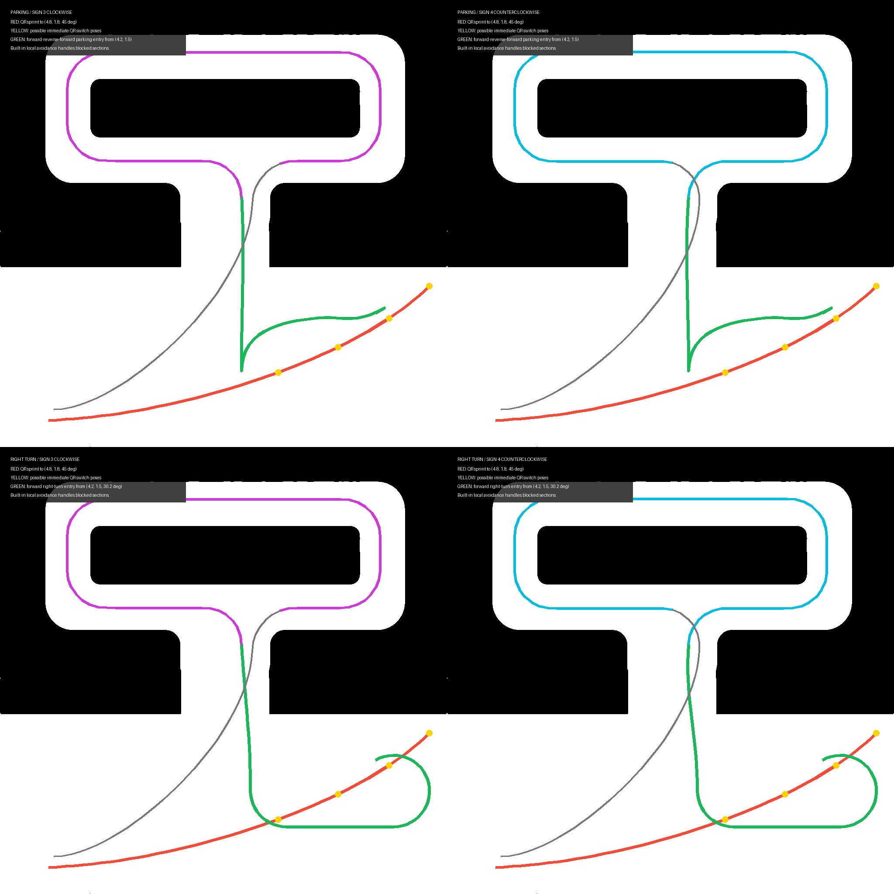

# 地瓜小车新人培训

这套资料面向第一次接触 Linux、ROS 2 和移动机器人的队员。读完后，你应能看懂小车的数据流，独立启动一个练习工作空间，录一段 rosbag，并用 RViz 2 和命令行定位问题。

教练交付时只打包本目录中除 `archive/` 以外的内容。`archive/` 是教练保留的基线副本，不属于新人资料。

三个 demo 都能完成“沿路径导航并绕开障碍物”。它们关注的技术边界不同：

| demo | 核心输入 | 核心输出 | 学习重点 |
| --- | --- | --- | --- |
| 1. 视觉巡线 | `/win_detection` 的 YOLO 框 | `/cmd_vel` | 检测框解析、状态机、PID 和视觉避障 |
| 2. Nav2 + TEB | 录制路径、TF、`/scan` | `controller_server` 的 `/cmd_vel` | TF 树、全局路径选择、局部代价地图、TEB 调参 |
| 3. LIO | `/scan`、`/imu/data`、`/odom` | LIO 里程计和纯追踪 `/cmd_vel` | 时间同步、去畸变、外参、NDT/ICP、局部避障 |

## 建议顺序

先读 [技术栈地图](architecture.md)，再完成 [环境准备](basics/environment.md) 和 [ROS 2 基础](basics/ros2-basics.md)。之后按 demo 1、demo 2、demo 3 的顺序学习。每个 demo 都先用录包或仿真输入跑通，再上车。

## 目录

- [技术栈地图](architecture.md)
- [环境准备：Ubuntu、ROS 2、VS Code 和 Codex](basics/environment.md)
- [ROS 2 基础与常用命令](basics/ros2-basics.md)
- [录包、回放和调试](basics/bag-debug.md)
- [调查依据与版本说明](research-notes.md)
- [教练验收基线](reference-stack.md)
- [Demo 1：纯视觉巡线与避障](demos/demo1-visual-deep.md)
- [Demo 2：Nav2 + TEB 路径导航](demos/demo2-nav2-teb-deep.md)
- [Demo 3：二维 LIO 编写与使用](demos/demo3-lio-deep.md)
- [Demo 1 使用说明](demos/demo1-guide.md)
- [Demo 2 使用说明](demos/demo2-guide.md)
- [Demo 3 使用说明](demos/demo3-guide.md)
- [代码阅读索引](source-walkthrough.md)

## 代码骨架

- `demos/demo1_visual_ws`：C++ 视觉控制器，只保留 YOLO/`cmd_vel` 接口和零速占位，PID、解析、避障和状态机由队员补齐。
- `demos/demo2_nav2_teb_ws`：Python 路径发布器、Nav2/TEB 参数和启动骨架。
- `demos/demo3_lio_ws`：C++ LIO 节点，TODO 位于去畸变、假点过滤、预测和配准处。

三个目录里的包可以直接复制到 dove 工作空间的 `src/` 后构建和启动，复制方法、默认命令和运行边界见 [`demos/README.md`](demos/README.md)。外层 `*_ws` 只是培训包中的组织目录，不是需要整体复制的工作空间。

骨架没有给出完整比赛实现，队员需要补齐各 demo 的 TODO，并提交参数记录、rosbag 和复盘报告。

## 两个月节奏

建议每周保留一晚理论、一次录包实验和一次代码复盘：第 1--2 周完成 Linux、ROS 2、消息和 rosbag；第 3--4 周完成 Demo 1 的 ROI 解析、PID、丢线和避障状态机；第 5--6 周完成 Demo 2 的 TF、EKF、地图/代价地图和 TEB 单参数实验；第 7--8 周完成 Demo 3 的时间同步、去畸变、过滤、预测和 ICP/NDT 验收。每个 demo 先离线或悬空测试，再在教练确认单一 `/cmd_vel` 控制权后低速上车。

## 交付边界

培训包只包含本目录中的讲义、图示、参数和三个教学工作空间。讲义使用接口契约和代码骨架解释整车架构，不要求队员访问比赛源码。

车端底盘驱动、相机驱动、雷达驱动、IMU 驱动、轮速里程计、厂商消息包和导航插件在运行环境中提供。具体保留项见 [依赖清单](dependencies.md)。

## 运行可行性边界

三个教学工作空间的 Python、XML、YAML 已通过语法检查，C++ 文件已完成接口和依赖核对。当前目录是 SSHFS 挂载工作空间；按环境约定不在这里执行构建，因此这里不能宣称已经完成 ROS 2 编译或上车验收。

| 工作空间 | 补齐 TODO 后的预期 | 教练端必须验证 |
| --- | --- | --- |
| `demo1_visual_ws` | 接收录包中的 `PerceptionTargets`，发布视觉 `/cmd_vel` | `ai_msgs` 消息字段、相机分辨率、底盘控制权和低速避障 |
| `demo2_nav2_teb_ws` | 发布路径，并由队员接入 `FollowPath`、TF 和 TEB | Nav2 生命周期、TEB 插件加载、代价地图和单一 `/cmd_vel` |
| `demo3_lio_ws` | 输出经过去畸变和匹配更新的二维里程计 | IMU/轮速/雷达时间覆盖、外参、静止漂移和墙体稳定 |

所以，“代码填完后能否运行”要分两步判断：先在 Linux 车端用实际依赖完成 `colcon build`，再用静止、直行、转弯和单障碍物 rosbag 验证。教学骨架本身不包含完整底盘、厂商消息、TEB 插件和 LIO 参考实现，不能只凭本目录在 Windows 上通过语法检查就下结论。
