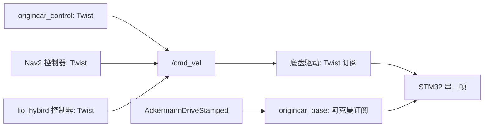
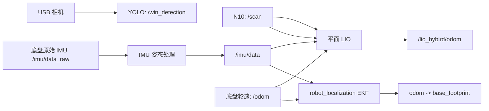
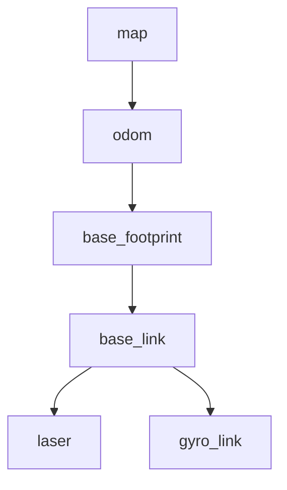

# 整车软件架构与数据流

本文按数据从硬件到控制器的顺序说明整车代码。目标读者是刚开始接触这个培训包的队员。读完后，你应能从一个 ROS 2 话题追到产生它的节点、消息类型和下游消费者。

## 一条控制命令怎样到达车轮

小车有两个命令接口。上层控制器通常发布 `geometry_msgs/msg/Twist` 到 `/cmd_vel`。底盘驱动也能直接接收 `ackermann_msgs/msg/AckermannDriveStamped`，话题默认是 `/ackermann_cmd`。不要只看“都叫速度”，要先确认消息类型和当前启动的订阅者。



车端底盘节点同时创建 `/cmd_vel` 和 `/ackermann_cmd` 两个订阅。`Twist.linear.x` 与 `Twist.angular.z` 会按底盘协议编码；阿克曼消息则从 `drive.speed` 和 `drive.steering_angle` 取值。培训包只保留接口说明，不携带底盘串口实现。另一个转换节点把角速度换算为转向角，轴距使用 0.143 m。两种路径不能同时接管同一底盘。

ROS 2 的 `/cmd_vel` 可以有多个发布者，但小车执行时只能有一个控制器拥有运动命令。视觉控制、Nav2/TEB 和 LIO 控制器必须通过 launch 选择其一，或用明确的控制权仲裁节点切换。启动前用下面的命令检查发布者：

```bash
ros2 topic info /cmd_vel -v
ros2 topic info /ackermann_cmd -v
```

## 传感器、状态估计和 TF



底盘发布轮速里程计 `/odom` 和原始 IMU `/imu/data_raw`。EKF 输入轮速和 IMU，输出连续里程计。串口字节解码、IMU 姿态计算和传感器融合是三层不同职责。培训包不包含这三层的厂商实现，只约定它们的输入输出。

LIO 节点再单独订阅 `/odom`、`/imu/data` 和 `/scan`，输出场地坐标系下的 `/lio_hybird/odom`。完整参考参数默认关闭 LIO 自己的 TF 发布，因为底盘 EKF 已经发布 `odom -> base_footprint`。如果两个节点同时给 `base_footprint` 发布父变换，TF 树就不再是单父树，Nav2 查询会产生冲突或结果不确定。

常见 TF 树应当是一条父子链。具体 frame 名必须读取运行参数和消息头，不能照抄示意图：



车端 `base_orin` 的 bringup 就是这条链：EKF 发布 `odom -> base_footprint`，静态 TF 发布 `base_footprint -> base_link`、`base_link -> laser`（`x = -0.03`，`z = 0.23`）和 `base_link -> gyro_link`。IMU 系的名字是 `gyro_link`，不是 `imu_link`。

用 `ros2 run tf2_tools view_frames` 生成树，用 `ros2 run tf2_ros tf2_echo odom base_footprint` 查单条变换。若 Nav2 使用 `map` 作为全局 frame，还要提供 `map -> odom`。没有全局地图时，可以让固定路径和控制器共用局部连续 frame，但路径的 `header.frame_id` 必须与控制器配置一致。

## 三条平等的导航路线

三条路线都会形成“感知或定位输入 → 路径/目标误差 → 控制命令 → 底盘”的过程。它们的区别是输入数据和算法边界，不是功能高低。

| 路线 | 位置或路径输入 | 避障依据 | 核心实现 |
| --- | --- | --- | --- |
| 纯视觉 | 图像检测框中的线路位置 | YOLO 障碍物框 | `origincar_control` |
| Nav2 + TEB | 录制路径或全局规划路径、TF | LaserScan 局部代价地图 | Nav2 `controller_server` 和 TEB 插件 |
| LIO 路径跟踪 | LIO 位姿和 CSV 路径 | 雷达点、车体包络和路径约束 | `lio_hybird` 的 LIO 节点与纯追踪节点 |

**纯视觉**不需要先建立米制地图。它直接用图像横坐标误差修正转向，因此适合用来学习检测框数据结构和控制器调参。光照、遮挡、检测框跳动会直接影响控制。

**Nav2 + TEB**把导航任务拆成路径、代价地图和控制器。全局规划器可以从栅格地图生成新路径；也可以直接把 `dzfollowpath` 记录的路径送给 `FollowPath`。后者没有 Nav2 全局规划器参与，仍然可以由 TEB 做局部轨迹优化。

**LIO 路线**自己估计平面位姿，再由纯追踪控制器跟录制路径。完整参考实现使用五状态平面滤波器、NDT 子地图和 ICP 兜底，并在控制器内完成雷达确认、墙体过滤、局部轨迹采样和恢复。教学骨架只把这些模块拆成 TODO，便于队员逐步实现。

## 从教学工作空间进入代码

先看包清单和启动文件，再看节点构造函数中的参数、订阅和发布，最后跟回调函数。按下面顺序读，可以尽早理解车体运动接口：

1. [`visual_controller.cpp`](demos/demo1_visual_ws/src/demo1_visual_control/src/visual_controller.cpp)：YOLO 框如何变成视觉控制量。
2. [`visual_controller.yaml`](demos/demo1_visual_ws/src/demo1_visual_control/config/visual_controller.yaml)：视觉控制器的起始参数。
3. [`path_source.py`](demos/demo2_nav2_teb_ws/src/demo2_nav2_teb/demo2_nav2_teb/path_source.py)：录制路径怎样变成 `nav_msgs/msg/Path`。
4. [`nav2_full_params.yaml`](demos/demo2_nav2_teb_ws/src/demo2_nav2_teb/config/nav2_full_params.yaml)：Nav2 节点层级、局部代价地图和 TEB 参数骨架。
5. [`lio_student_node.cpp`](demos/demo3_lio_ws/src/demo3_lio/src/lio_student_node.cpp)：传感器时间怎样进入 LIO 教学节点。
6. [`lio_student.yaml`](demos/demo3_lio_ws/src/demo3_lio/config/lio_student.yaml)：LIO 外参和关键帧参数。

教练验收完整路线时，再对照三个包的接口边界：视觉控制器只发布视觉命令；Nav2 路线由 `controller_server` 和 TEB 发布命令；LIO 路线由 LIO 纯追踪节点发布命令。三个路线不能同时启动。

培训包只包含教学节点。运行时还需要车端提供底盘、传感器、定位和导航依赖。独立的 Nav2 + TEB demo 应由自己的 launch、参数和控制权检查负责。

## 看问题先看哪一层

| 现象 | 先检查 | 再检查 |
| --- | --- | --- |
| 车完全不动 | `/cmd_vel` 是否有发布者、底盘串口节点是否收到 | Twist 与 Ackermann 两条输入是否同时工作 |
| 车按错误方向转 | 图像误差符号和 `angular.z` 符号 | 底盘转角编码、轮距/轴距和 frame 朝向 |
| RViz 没有雷达 | Fixed Frame、`/tf` 和 `/tf_static` | LaserScan 的 `header.frame_id` 与时间戳 |
| Nav2 报 TF extrapolation | frame 名、消息时间、ROS 时间源 | IMU/轮速与雷达是否使用同一时钟 |
| LIO 墙体旋转或弯曲 | LaserScan 束时间、扫描顺序 | IMU 时间覆盖、雷达外参和运动预测 |
