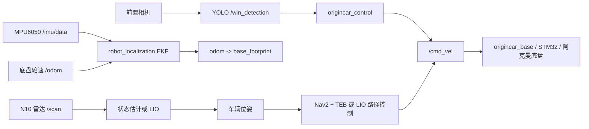
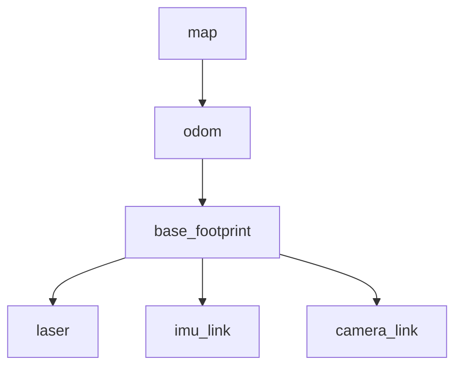

# 技术栈地图

## 一辆车怎样从传感器走到动作

同一时刻只能有一个控制器发布有效运动指令。调试时先执行 `ros2 topic info /cmd_vel -v`，确认发布者数量和节点名称。

## 硬件和软件对应关系

| 层 | 组件 | 作用 |
| --- | --- | --- |
| 主控 | RDK X5、Ubuntu 22.04、TROS | 运行 ROS 2 节点和模型推理 |
| 底盘 | STM32、阿克曼机构 | 接收速度/转角，回传轮速和 IMU |
| 视觉 | USB 相机、YOLOv8 BPU 模型 | 找线、找障碍物和二维码 |
| 几何感知 | 轮趣 N10 单线雷达 | 看到墙、锥桶和场地边界 |
| 状态估计 | `robot_localization`、`lio_hybird` | 输出连续的车辆位姿 |
| 导航 | Nav2、TEB、录制路径 | 生成跟踪路径和局部避障轨迹 |
| 开发 | colcon、RViz 2、rosbag、VS Code | 构建、可视化、复盘和协作 |

## TF 树的基本约束

`base_footprint` 只能有一个父节点。当前底盘 EKF 已发布 `odom -> base_footprint`，LIO 默认不再重复发布同一个子坐标系的 TF。`laser` 和 `imu_link` 的静态外参必须以实测标定值为准。

## 当前代码中的关键事实

- `origincar_control` 从 `ai_msgs/msg/PerceptionTargets` 读取 `hat`、`line`、`p` 和 `code` 的矩形框。
- 第一段巡线的中心约为 `x = 920`，视觉角速度主要由线中心误差乘比例系数得到。原代码里的 PID 主要用于避障和二维码对准。
- `lio_hybird` 的平面状态为 `[x, y, yaw, 纵向速度, 陀螺零偏]`，扫描按关键帧进入 NDT 子地图，启动阶段或 NDT 拒绝时使用 ICP 兜底。
- `NdtLIO` 参考代码提供了更完整的 IMU 去畸变、增量 NDT、ESKF/IESKF 和占据栅格结构。培训 demo 只要求先完成二维、可观测、可复盘的版本。
