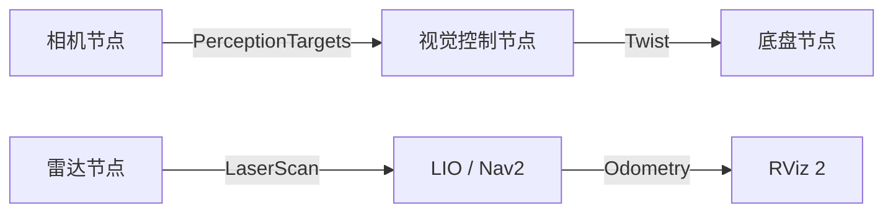

# ROS 2 基础

## 四个概念

节点是一个运行中的程序。话题传输连续数据。服务适合短请求。Action 适合带反馈的长任务，例如 Nav2 的 `FollowPath`。参数用于在不改代码时调整行为。



## 必会命令

```bash
ros2 node list
ros2 topic list
ros2 topic info /scan -v
ros2 topic echo /odom --once
ros2 topic hz /imu/data
ros2 interface show sensor_msgs/msg/LaserScan
ros2 param list /controller_server
ros2 param get /controller_server controller_frequency
ros2 action list
ros2 lifecycle get /controller_server
ros2 run tf2_tools view_frames
```

## QoS 和时间

雷达和 IMU 通常使用 SensorData QoS。订阅端 QoS 不匹配时，节点可能存在但收不到数据。每条消息都有时间戳，LIO 必须按时间戳配对 IMU、轮速和扫描，不能用“最近收到的消息”代替。

## 参数和 launch

YAML 只表达参数值，launch 负责组合节点、参数和 remap。修改源目录后要重新 `colcon build`，再 `source install/setup.bash`。如果日志仍显示旧参数，先检查 `ros2 pkg prefix <包名>` 和当前进程，而不是继续盲调。
