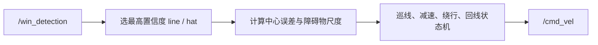

# Demo 1：纯视觉巡线与避障

## 任务目标

在一段有颜色引导线和 1～2 个静态障碍物的直线赛道上，车辆从起点出发，沿线行驶，减速绕障，重新找回线路并停车。任务只要求前进，不加入二维码和控制权交接。

## 你要先看懂的现有代码

`origincar_control.cpp` 的 `yolo_callback` 遍历 `PerceptionTargets.targets`，再遍历每个 `roi`。`target.type` 是 `line`、`hat`、`p` 或 `code`。矩形中心、宽高和置信度会进入后续决策。现有代码的 `REAL_MIDX = 920`、`xunxian_k = 0.0016` 和障碍物高度比例阈值是本题的起始参考。



## 待完成部分

1. 补齐丢线状态机：`TRACKING`、`SEARCHING`、`STOPPED`。丢线后不能继续高速直行。
2. 将障碍物判断从单帧阈值改为“连续确认 + 过期时间”。
3. 根据障碍物中心相对线路中心选绕行侧，绕行期间锁定方向，避免左右抖动。
4. 实现带 anti-windup 的 PID，用实际 `dt` 计算微分项，并给输出限幅。
5. 发布调试话题或日志：线误差、P/I/D、障碍物比例、当前状态和角速度。

## 学习路线

先用固定框消息或 rosbag 验证矩形解析，再只启用比例控制，最后加入 PID 和避障状态机。一次只改 `line_kp`、`Kp/Ki/Kd`、触发阈值中的一个。曲线振荡先降 `Kp` 或减小速度；响应慢再增加 `Kp`；持续偏置才考虑 `Ki`；噪声大时先检查检测框抖动，再处理 `Kd`。

## 验收标准

- 无障碍时连续 20 m，线中心误差的 95% 分位小于 80 px。
- 单个障碍物前能减速，绕行侧不在相邻 10 帧内切换。
- 绕障后 2 s 内重新进入线路跟踪，不能因为暂时丢线而冲出赛道。
- rosbag 中能解释每一次速度变化，不能只凭“看起来更稳”。

## 参考命令

```bash
cd training/demos/demo1_visual_ws
source /opt/ros/humble/setup.bash
colcon build --symlink-install
source install/setup.bash
ros2 launch demo1_visual_control demo1.launch.py
ros2 topic echo /cmd_vel
```

## 交付物

源代码、参数表、一段成功 rosbag、一张误差曲线和一页复盘。复盘要写清楚：检测框来自哪个话题，误差如何定义，为什么这样调 PID，失败时车辆处于哪个状态。
