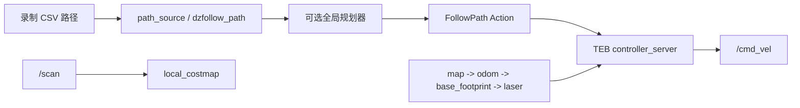

# Demo 2：Nav2 + TEB 路径导航

## 任务目标

车辆读取一段录制路径，在 TF 树和局部雷达障碍物的约束下完成路径跟踪。障碍物出现在路径中间时，由 TEB 在局部范围内绕行。全局规划器是否参与由队员自行选择，但必须说明选择依据。

## 方案边界

Nav2 是导航框架。`controller_server` 接收路径并调用局部控制器。TEB 将车辆运动学、速度限制、障碍物和路径误差放进优化问题，输出短时轨迹。`dzfollow_path` 可以作为录制路径的输入适配器。它们与视觉控制和 LIO 都是平等的导航实现路线。

今年比赛最终采用了 `lio_hybird` 内置纯追踪和局部避障，没有把 Nav2/TEB 留在最终控制链上。原因包括控制器竞争、路径方向切换和调试面扩大。这个 demo 仍然保留，因为它能让新人系统理解 TF、代价地图、FollowPath 和局部规划器。

## 数据流



## 待完成部分

1. 补齐 `FollowPath` Action client，把 `/demo2/reference_path` 转成 Nav2 可消费的路径。
2. 决定 `map`、`odom` 和 `base_footprint` 的责任边界，并用 `view_frames` 验证每条边。
3. 配置局部代价地图的 marking、clearing、膨胀半径和雷达观测坐标系。
4. 选择是否加入全局规划器。录制路径方案需要处理起点偏差、路径截断和方向切换。
5. 逐项调 TEB：速度上限、转向限制、前进偏好、障碍物权重、优化迭代次数和控制频率。

## 调参顺序

先无障碍、低速跑通 TF 和路径跟踪；再加入单个障碍物；最后才测试狭窄通道和倒车。每次只改一组参数，记录成功率、最小障碍物距离、TEB 单周期耗时、倒车距离和 LIO/雷达丢帧数。`width`、`height` 等 YAML 类型必须与车端 Nav2 版本一致，整数和浮点数错误会让 lifecycle 节点启动失败。

## 验收标准

- `controller_server` 进入 `active`，`/follow_path` action 存在。
- RViz 2 中能同时看到参考路径、局部代价地图和 TEB 局部轨迹。
- 障碍物阻挡路径时车辆能绕开，移除障碍物后能回到路径。
- 只能有一个 `/cmd_vel` 控制器。用 `ros2 topic info /cmd_vel -v` 留下证据。

## 参考命令

```bash
cd training/demos/demo2_nav2_teb_ws
source /opt/ros/humble/setup.bash
colcon build --symlink-install
source install/setup.bash
ros2 launch demo2_nav2_teb demo2.launch.py path_file:=/path/to/path.csv
ros2 launch demo2_nav2_teb demo2.launch.py path_file:=/path/to/path.csv start_controller:=true
ros2 lifecycle get /controller_server
ros2 action list
```

## 交付物

一张 TF 树、一张代价地图和局部轨迹截图、一份 TEB 参数对照表、两段相同障碍摆位的 rosbag，以及“采用/不采用全局规划器”的技术说明。

## 参考资料

- [Nav2 官方文档](https://docs.nav2.org/)
- [ROS 2 TF2 教程](https://docs.ros.org/en/humble/Tutorials/Intermediate/Tf2/Tf2-Main.html)
- [TEB Local Planner 文档](http://wiki.ros.org/teb_local_planner)
