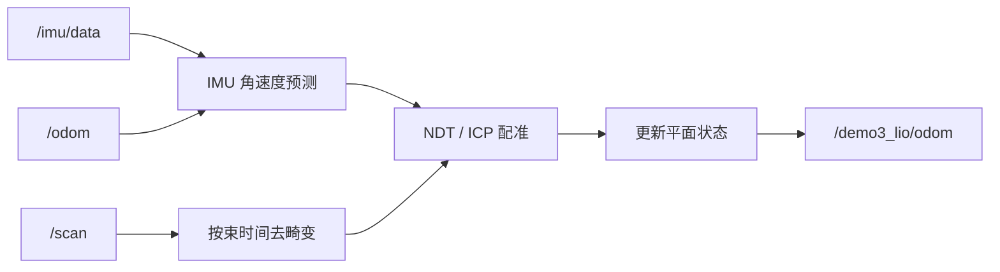

# Demo 3：二维 LIO 编写与使用

## 任务目标

用 N10 二维雷达、IMU 和轮速估计车辆在室内平面场地中的位姿。先实现稳定、可复盘的二维版本，再考虑更复杂的优化。避障只要求输出可信的几何障碍物，不要求完成比赛级绕障。

## 两份参考实现

本仓库的 `lio_hybird/src/submap_lio_node.cpp` 采用五状态平面模型，用轮速纵向速度和 IMU 角速度做预测，再用去畸变后的扫描匹配关键帧 NDT 子地图。`lio_ob` 保留了相同接口并提供实验配置。

`NdtLIO` 的结构更适合作为算法阅读材料：`Frontend` 管时间缓存、去畸变和关键帧，`NdtInc2d` 管增量体素 NDT，ESKF/IESKF 管状态更新，`OccupancyMap` 管栅格地图。它还明确指出雷达束时间顺序、`T_IL` 外参和静止初始化对结果的影响。

## 数据流



## 待完成部分

1. 维护带时间戳的 IMU 缓存，按每束扫描的相对时间插值姿态。
2. 过滤 NaN、越界、孤立反射和不符合邻束连续性的点。保留原始 `/scan`，只对 LIO 输入做过滤。
3. 使用实测 `laser -> imu` 外参，把雷达点变换到统一坐标系。不要把单位外参当成最终结果。
4. 用 IMU 和轮速预测位姿，按位移或转角插入关键帧。
5. 完成二维 NDT 或点到线 ICP，加入有效点数量、残差和协方差门限。匹配失败时保持预测并报警，不能输出 NaN。
6. 输出诊断：扫描延迟、有效点数、NDT 接受率、ICP 回退次数和当前协方差。

## 现象与原因

墙体“转动”通常来自扫描运动畸变、时间戳顺序错误或雷达外参错误。车辆快速转弯时，若把一整帧点当成同一时刻，墙会弯曲或旋转。雷达假点会让匹配产生错误局部最优，因此要先做几何过滤，再用配准残差和观测门限拒绝异常更新。IMU 的姿态四元数如果只是同一路陀螺积分，不能再作为独立绝对航向观测，否则会重复计算同一信息。

## 验收标准

- 静止 60 s，输出位姿不发散，陀螺零偏估计稳定。
- 直线 5 m 往返，位置闭环误差和航向误差有明确统计。
- 原地转动时墙体不出现明显旋转，能解释去畸变前后的差异。
- 人为插入少量 NaN、远距离点和孤立点后，节点不崩溃，NDT 能拒绝坏观测并继续输出预测。

## 参考命令

```bash
cd training/demos/demo3_lio_ws
source /opt/ros/humble/setup.bash
colcon build --symlink-install
source install/setup.bash
ros2 launch demo3_lio demo3.launch.py
ros2 topic hz /demo3_lio/odom
ros2 topic echo /demo3_lio/odom --once
```

## 交付物

节点源码、参数文件、外参测量记录、静止/直行/转弯三段 rosbag、轨迹图和失败分析。报告必须区分“预测漂移”“匹配错误”“TF 错误”和“时间同步错误”。
