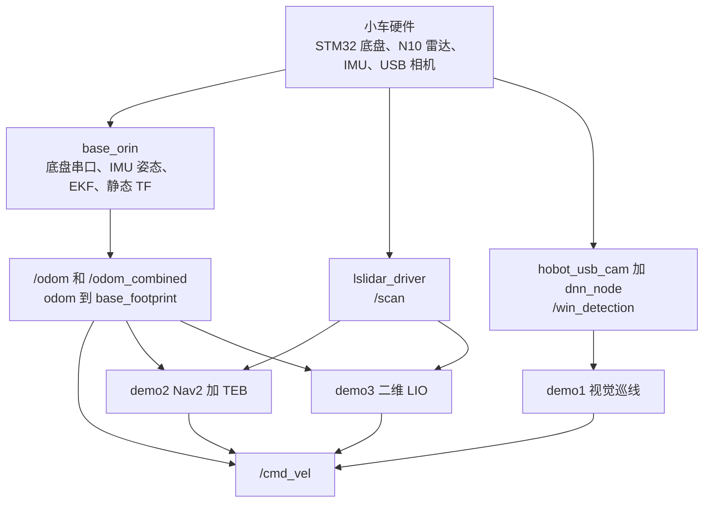
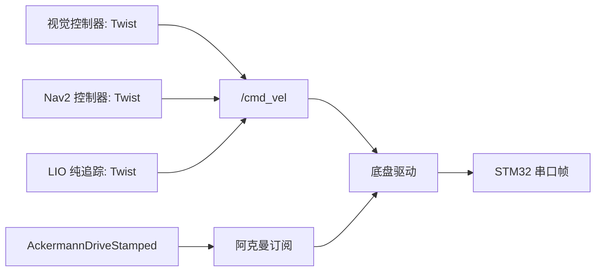
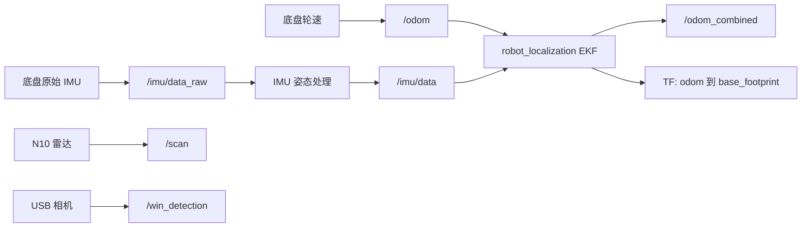
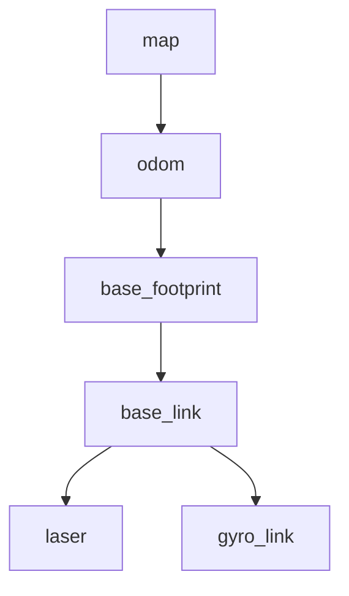

# 三个教学包：技术报告与培训资料

这份报告配合 `training/demos/` 下的三个 ROS 2 包使用，面向第一次接触这台地瓜小车的新队员。读完你应该能回答三个问题：这台车现在能跑什么，三个练习任务各自要求你做什么，以及你和比赛版本之间还差多远。

报告分九章。第一章说明文档本身的来历和验证边界，第二章到第四章讲车的整体情况，第五章到第七章是三个任务的详细说明，第八章和第九章是查表和排错用的。

## 目录

- [1 这份报告是什么](#1-这份报告是什么)
  - [1.1 这些包是怎么来的](#11-这些包是怎么来的)
  - [1.2 验证边界](#12-验证边界)
  - [1.3 知识谱系](#13-知识谱系)
  - [1.4 建议的阅读顺序](#14-建议的阅读顺序)
- [2 快速上手](#2-快速上手)
  - [2.1 前提](#21-前提)
  - [2.2 复制和编译](#22-复制和编译)
  - [2.3 先起前置包](#23-先起前置包)
  - [2.4 三条最小的启动命令](#24-三条最小的启动命令)
  - [2.5 确认数据流](#25-确认数据流)
  - [2.6 上车前的最低要求](#26-上车前的最低要求)
  - [2.7 第一步就失败的话](#27-第一步就失败的话)
- [3 系统架构与数据流](#3-系统架构与数据流)
  - [3.1 一条控制命令怎样到达车轮](#31-一条控制命令怎样到达车轮)
  - [3.2 传感器和状态估计](#32-传感器和状态估计)
  - [3.3 TF 树](#33-tf-树)
  - [3.4 三条路线怎么分](#34-三条路线怎么分)
  - [3.5 demo 和车端代码的对应关系](#35-demo-和车端代码的对应关系)
  - [3.6 时间源](#36-时间源)
- [4 任务边界与验收](#4-任务边界与验收)
  - [4.1 三个任务共用的边界](#41-三个任务共用的边界)
  - [4.2 demo1 视觉巡线](#42-demo1-视觉巡线)
  - [4.3 demo2 Nav2 加 TEB](#43-demo2-nav2-加-teb)
  - [4.4 demo3 二维 LIO](#44-demo3-二维-lio)
  - [4.5 和比赛版本比缺了什么](#45-和比赛版本比缺了什么)
  - [4.6 三条路线的验收客观性不一样](#46-三条路线的验收客观性不一样)
- [5 demo1 视觉巡线](#5-demo1-视觉巡线)
  - [5.1 这个任务在练什么](#51-这个任务在练什么)
  - [5.2 车端实现是怎么做的](#52-车端实现是怎么做的)
  - [5.3 骨架留下了什么](#53-骨架留下了什么)
  - [5.4 你要写的代码](#54-你要写的代码)
  - [5.5 接口契约](#55-接口契约)
  - [5.6 怎么跑怎么调](#56-怎么跑怎么调)
  - [5.7 常见坑](#57-常见坑)
  - [5.8 验收](#58-验收)
- [6 demo2 Nav2 加 TEB](#6-demo2-nav2-加-teb)
  - [6.1 这个任务在练什么](#61-这个任务在练什么)
  - [6.2 车端实现是怎么做的](#62-车端实现是怎么做的)
  - [6.3 骨架留下了什么](#63-骨架留下了什么)
  - [6.4 你要写的内容](#64-你要写的内容)
  - [6.5 接口契约](#65-接口契约)
  - [6.6 三级启动台阶](#66-三级启动台阶)
  - [6.7 常见坑](#67-常见坑)
  - [6.8 验收](#68-验收)
- [7 demo3 二维 LIO](#7-demo3-二维-lio)
  - [7.1 这个任务在练什么](#71-这个任务在练什么)
  - [7.2 车端实现是怎么做的](#72-车端实现是怎么做的)
  - [7.3 骨架留下了什么](#73-骨架留下了什么)
  - [7.4 你要写的代码](#74-你要写的代码)
  - [7.5 接口契约](#75-接口契约)
  - [7.6 怎么跑怎么调](#76-怎么跑怎么调)
  - [7.7 常见坑](#77-常见坑)
  - [7.8 验收](#78-验收)
- [8 索引](#8-索引)
  - [8.1 包](#81-包)
  - [8.2 节点与可执行](#82-节点与可执行)
  - [8.3 话题](#83-话题)
  - [8.4 frame](#84-frame)
  - [8.5 消息结构](#85-消息结构)
  - [8.6 参数文件](#86-参数文件)
  - [8.7 命令速查](#87-命令速查)
  - [8.8 三个包的文件清单](#88-三个包的文件清单)
- [9 常见故障](#9-常见故障)

## 1 这份报告是什么

### 1.1 这些包是怎么来的

三个包都是从车端已经跑通的比赛实现里裁出来的教学版本。裁的时候保留接口、参数入口、启动流程和一层安全占位，把核心实现挖成 TODO。所以这三个包能编译、能启动、能看到数据流，但不会替你完成任务，未完成前也不会让车动起来。

裁不是简单删代码。凡是刻意留下的数值和命名，都和车端实现对齐；凡是必须你自己测出来的量，都留成占位值或者标成 TODO。哪一项属于哪一类，第五到第七章逐条写明。

### 1.2 验证边界

到目前为止做过的检查只有两类：Python、XML、YAML 和 RViz 配置的语法解析，以及各包 yaml 里的参数名与代码里 `declare_parameter` 的名字双向比对。没有做过的：C++ 编译、ROS 2 节点启动、上车运动验证、RViz 渲染效果。

所以下文“接口和依赖对得上”是有依据的，“填完参数就能跑通”要你在车端自己确认。差异会在运行阶段暴露，暴露了就按第九章的顺序排。

### 1.3 知识谱系



三条路线共用同一套底盘和传感器，区别只在三个地方：位置从哪里来，障碍从哪里来，谁发控制量。三条路线都会写 `/cmd_vel`，所以同一时间只能起一条。这张图的展开版本在第三章。

### 1.4 建议的阅读顺序

先读第二章，把包跑起来并看到数据。再读第三章，弄清话题和 TF 树。然后读你分到的那一个 demo 章节，边读边对着代码看。最后读第四章，确定做到什么程度算完成。第八章和第九章留到查表的时候用。

## 2 快速上手

这篇的目标是让你在一个小时内看到三个包的数据流。跑通不等于做完任务，三个包在 TODO 补完前都只会输出零速度或只发路径，这是刻意的安全设计。

### 2.1 前提

车端是 Ubuntu 22.04 加 RDK/TROS Humble，系统环境用一个命令进：

```bash
source /opt/tros/humble/setup.bash
```

这台车的 bashrc 里已经带了这句，新开终端会自动执行。写出来是因为换终端或者切到 sudo 之后可能忘了它，忘了就会报找不到 `ai_msgs`、`nav2_msgs` 这类依赖包。

### 2.2 复制和编译

三个目录本身就是 ROS 2 package。只复制包目录，不要复制外层 `*_ws`，也不要复制 `build/`、`install/`、`log/`。

```bash
cd /userdata/dev_ws
cp -a <training>/demos/demo1_visual_ws/src/demo1_visual_control src/
cp -a <training>/demos/demo2_nav2_teb_ws/src/demo2_nav2_teb src/
cp -a <training>/demos/demo3_lio_ws/src/demo3_lio src/
colcon build --symlink-install --packages-select \
  demo1_visual_control demo2_nav2_teb demo3_lio
source install/setup.bash
```

三个包装在同一个工作空间里可以，同时启动不行。它们都会发布 `/cmd_vel`，一起启动就是三个控制器抢一台车。

### 2.3 先起前置包

demo 只提供控制逻辑，传感器和底盘由车端已有的包提供。顺序是底盘、雷达、相机，最后才是 demo。

```bash
# 底盘串口、IMU、EKF 和静态 TF
ros2 launch base_orin origincar_bringup.launch.py

# N10 雷达，发布 /scan
ros2 launch lslidar_driver lsn10_net_launch.py

# 相机加 YOLO 推理，发布 /win_detection，只有 demo1 需要
ros2 launch origincar_bringup move_yolo.launch.py
```

`move_yolo.launch.py` 默认读 `/userdata/dev_ws/config/new.json` 作为模型配置。这个文件不在训练包里，由教练准备。

### 2.4 三条最小的启动命令

每条都先跑观察模式，确认数据对了再往下走。

```bash
# demo1：订阅 /win_detection，向 /cmd_vel 发零速度
ros2 launch demo1_visual_control demo1.launch.py

# demo2：只发路径，不起 Nav2，不开安全门
ros2 launch demo2_nav2_teb demo2.launch.py start_nav2:=false send_goal:=false rviz:=true

# demo3：LIO 占位输出加控制器零速度
ros2 launch demo3_lio demo3.launch.py rviz:=true
```

`rviz:=true` 会打开随包的 RViz 配置。demo2 的那份默认 Frame 是 `map`，demo3 的是 `odom`。

### 2.5 确认数据流

启动之后按顺序查这几条。任何一条不通，先解决它再往下。

```bash
ros2 topic hz /scan                      # 雷达在不在
ros2 topic hz /win_detection             # YOLO 在不在，只有 demo1 需要
ros2 topic echo /odom --once             # 轮速里程计
ros2 topic echo /odom_combined --once    # EKF 输出
ros2 run tf2_tools view_frames           # TF 树连不连通
ros2 run tf2_ros tf2_echo odom base_footprint
ros2 topic info /cmd_vel -v              # 谁在发控制量
```

`ros2 topic info /cmd_vel -v` 这条每条路线都要查。正常情况下只有一个发布者：视觉路线是视觉控制器，Nav2 路线是 `controller_server` 里的控制器插件，LIO 路线是纯追踪控制器。看到两个就要停下来。

### 2.6 上车前的最低要求

先离线或者架空车轮跑通，再低速实车。具体要求是三条：`/cmd_vel` 只有一个发布者，转向方向正确，急停手段在你手边。

三个包在 TODO 补完前不会输出非零速度，这是它们的默认保护。不要为了先试一下而绕开它。

### 2.7 第一步就失败的话

按第 9 章的现象表排。最常见的是三类：忘了 source 导致找不到包，前置包没起导致 TF 缺失，以及地图或参数没补导致 Nav2 起不来。

## 3 系统架构与数据流

这篇说明数据从硬件到车轮的完整通路，以及三个 demo 各自站在哪一段。读完你应该能从任意一个话题追到产生它的节点。

### 3.1 一条控制命令怎样到达车轮

底盘有两个命令接口。上层控制器通常发 `geometry_msgs/msg/Twist` 到 `/cmd_vel`，底盘也接受 `ackermann_msgs/msg/AckermannDriveStamped`，话题是 `/ackermann_cmd`。两个接口不能同时接管。



底盘驱动把 `Twist.linear.x` 和 `Twist.angular.z` 按协议编码后写串口。另有一个转换脚本把角速度换算成前轮转角，用的轴距是 0.143 m。两条输入路径最终都落到同一个串口，所以“谁在控制车”这件事只能有一个答案。

### 3.2 传感器和状态估计



这里有三层不同的职责，分清了就不会混淆：

- 轮速里程计 `/odom` 由底盘提供，会打滑、会漂。
- IMU 姿态处理把原始 IMU 变成可用的 `/imu/data`。
- EKF 融合前两者，输出连续平滑的 `/odom_combined`，并负责发布 `odom -> base_footprint` 这条边。

雷达和相机是另外两路独立的感知输入，不参与状态估计。

### 3.3 TF 树

车端真实的 TF 树是一条链，每条边的负责人不同：



| 边 | 谁发布 | 说明 |
| --- | --- | --- |
| `map` 到 `odom` | 定位节点，例如 AMCL | 只有用全局地图时才需要 |
| `odom` 到 `base_footprint` | EKF | 底盘推出来的连续位姿 |
| `base_footprint` 到 `base_link` | 静态 TF | 车体原点 |
| `base_link` 到 `laser` | 静态 TF | 实测值 `x = -0.03`，`z = 0.23` |
| `base_link` 到 `gyro_link` | 静态 TF | IMU 的 frame 名是 `gyro_link` |

有两个错误值得提前知道。第一，IMU 的 frame 不叫 `imu_link`，tf2 查询用错名字会直接报 frame 不存在。第二，`odom -> base_footprint` 已经由 EKF 发布，LIO 节点如果也发同一条边，这条边就有两个父节点，Nav2 查询会失败或者结果随机。

查树用 `ros2 run tf2_tools view_frames`，查单条边用 `ros2 run tf2_ros tf2_echo odom base_footprint`。

### 3.4 三条路线怎么分

| 路线 | 位置从哪里来 | 障碍从哪里来 | 谁发控制量 | 对应车端实现 |
| --- | --- | --- | --- | --- |
| demo1 视觉巡线 | 图像里检测框的横坐标 | YOLO 检测框 | 视觉控制器 | `origincar_control` |
| demo2 Nav2 加 TEB | 录制路径、TF、定位 | 雷达局部代价地图 | TEB 控制器插件 | `my_robot_nav` 加 `dzsavepath` |
| demo3 二维 LIO | 自己算的二维位姿 | 雷达点和车体包络 | 纯追踪控制器 | `lio_hybird` |

三条路线是平等的技术路线，不是难度等级。它们的区别在于把复杂性放在哪一段：demo1 放在感知到控制的映射上，demo2 放在框架集成上，demo3 放在状态估计上。

### 3.5 demo 和车端代码的对应关系

教学包按车端同样的接口重写，是简化版，和车端代码是两份不同的实现。

| demo 包 | 车端包 | 照搬的部分 | 重写的部分 |
| --- | --- | --- | --- |
| `demo1_visual_control` | `origincar_control` | 话题名、消息结构、图像坐标常量、检测类别名 | 节点结构改成一个类加五状态枚举，去掉二维码分支 |
| `demo2_nav2_teb` | `my_robot_nav`、`dzsavepath` | Nav2 参数层级、TEB 参数名、路径 CSV 格式、启动方式 | 路径解析从 C++ 挪到 Python，FollowPath 客户端挖空 |
| `demo3_lio` | `lio_hybird` | 传感器话题、雷达外参、关键帧阈值、体素大小 | 两个节点简化为骨架，参数从 60 多个缩到十几个 |

车端实现和三个 demo 的体量差距很大，具体数字在第 4 章。写出这些数字，是让你看到真实系统的复杂度在哪。

### 3.6 时间源

回放带 `/clock` 的录包时，所有节点都要 `use_sim_time:=true`，包括 Nav2 和 RViz。三个 demo 的 launch 都留了这个参数。混用时钟的典型现象是 TF 报 extrapolation，或者路径和雷达在 RViz 里错位。

## 4 任务边界与验收

这篇回答三个问题：每个练习任务要求你做什么，什么不在要求范围内，以及教学版本和比赛版本差多少。

### 4.1 三个任务共用的边界

三条路线都遵守同一组约束，越界就会出事故或者浪费时间。

同时只能启动一条路线。三个控制器都会发布 `/cmd_vel`，先起的那条会被后起的抢走控制权，现象是车突然按另一套逻辑走。

先离线或者架空车轮，再低速实车。控制器参数没有验过之前不要直接放地上跑。

不要求实现比赛级功能。下面每个 demo 的“明确不要求”一节会列出被裁掉的部分，那些是教练侧的工作，不属于这个练习的范围。

不要求你重写框架。demo2 的 Nav2 和 TEB 是现成的，demo3 的雷达驱动和底盘 EKF 也是现成的。你要做的是把缺口补上，不是从头造轮子。

### 4.2 demo1 视觉巡线

任务一句话：只用前置相机的检测结果，让车沿线路前进，遇到障碍物绕开，绕完回到线上。

必须实现：检测框解析与选择、横向误差到角速度的映射、带限幅的 PID、障碍物多帧确认与绕行方向锁存、丢线后的保持与搜索、状态切换时的历史量清理。

明确不要求：二维码识别与控制权交接、加速冲码、二线切换、倒车恢复、激光安全仲裁层。这些在车端都存在，但都不属于这个练习。

最低验收：车能沿直线段和缓弯段通过，遇到单个障碍物能减速并绕开，绕开后回到线路，丢线后能自己找回；`/cmd_vel` 始终只有一个发布者。

加分项：把调参过程记录成表，说明每个参数改动的现象和依据。

交付物：参数记录、录包、复盘报告。

### 4.3 demo2 Nav2 加 TEB

任务一句话：让车跟着一段录制的路径走，路径上出现障碍物时由 TEB 在局部绕开。

必须实现：可用的地图、完整的 Nav2 参数文件、FollowPath 客户端的发送与恢复逻辑。

明确不要求：自己写局部规划器或控制器插件、自己实现代价地图层、自己写行为树引擎。这些都是 Nav2 提供的，你负责配置和调用。

最低验收：`controller_server` 进入 `active`，路径能下发并被执行；RViz 里能同时看到参考路径、代价地图和控制器输出的局部轨迹；障碍物挡路时能绕开，移开后回到路径；`/cmd_vel` 只有一个发布者。

加分项：在“只用录制路径”和“加全局规划器”两种方案之间做对比，给出选择依据和计算开销数据。

交付物：一张 TF 树、一张代价地图与局部轨迹截图、一份 TEB 参数对照表、两段相同障碍摆位的录包，以及一份方案选择说明。

### 4.4 demo3 二维 LIO

任务一句话：用雷达、IMU 和轮速算出车在平面上的位姿，再在位姿基础上做路径跟踪和基本避障。

必须实现：按束时间去畸变、点的过滤、雷达到车体的外参变换、用里程计和 IMU 预测初值、扫描匹配与观测拒绝，然后把占位输出换成真的位姿；控制器侧实现坐标变换、前视点选择、曲率限制和避障回线状态机。

明确不要求：环视视觉定位、keepout 掩码约束、倒车脱困采样、二维码任务、自动生成路径。这些在车端都有，属于进阶或教练侧内容。

最低验收：静止 60 s 位姿不发散，陀螺零偏估计稳定；直线 5 m 往返给出位置和航向误差；原地转动时墙体不出现明显旋转；人为插入 NaN、远距离点和孤立点后节点不崩溃，并继续输出预测。

加分项：把预测漂移、匹配错误、TF 错误、时间同步错误四类现象区分开，各自给出证据。

交付物：节点源码、参数文件、外参测量记录、静止与直行与转弯三段录包、轨迹图、失败分析。

### 4.5 和比赛版本比缺了什么

这一节给具体数字和清单，方便你判断自己做到什么程度算“接近可用”。

| | 车端比赛实现 | 教学骨架 | 差额 |
| --- | --- | --- | --- |
| demo1 | `origincar_control`，966 行 | 约 150 行外壳加占位 | 四类目标解析、绕行侧推断、回线特判、二维码接管、加速冲码 |
| demo2 | `my_robot_nav` 加 `dzsavepath`，参数文件 412 行 | 路径发布约 120 行，参数文件结构完整但值留空 | 地图、参数取值、行为树、FollowPath 完整逻辑 |
| demo3 | `lio_hybird`，LIO 节点 64 KB，纯追踪节点 208 KB | 两个节点合计约 10 KB | 去畸变、ICP、NDT、观测拒绝、协方差、keepout、倒车恢复 |

#### demo1 缺的部分

车端除了巡线本身，还有一整套和比赛流程绑定的逻辑。激光安全层会根据 `/scan` 做前方减速、刹停、有限后退；二维码节点扫到码后，视觉控制器会释放 YOLO 订阅、发一次零速度、再通过 `/origincar_control/control_released` 宣布交出控制权，由另一条路线接手。还有加速冲码、扫不到码时减速、绕完障碍后跳过第二条线之类的特判。

教学版本把这些全部去掉了。目的一是让问题限制在“检测框到控制量”这一段，二是控制权交接这类逻辑必须配合真实比赛流程才有意义。

#### demo2 缺的部分

按重要性排序：一张真实的地图（现在附带的是一张 100×100 的空白占位图，不能用于导航）、TEB 那 80 个参数的具体取值、AMCL 的初始位姿、行为树 XML 的选择与 `plugin_lib_names` 清单、全局规划器插件的选择，以及 `dzfollowpath` 里“abort 后清理局部代价地图再延迟重发”的完整恢复策略。

导航所需的插件本身不缺。TEB 插件、代价地图、Nav2 全套都在车端环境里，你要做的是把它们配对。

#### demo3 缺的部分

车端的 LIO 节点有 60 多个参数，教学骨架只留了 13 个。缺的主要是三类：扫描时间与队列（`scan_index_time_reversed`、`scan_stamp_is_end`、`max_pending_scans`）、配准门限（一组 `icp_*` 和 `ndt_*`）、以及滤波参数（协方差和零偏那一组）。

控制侧缺得更多。车端的纯追踪节点还做 keepout 掩码约束、车体包络检查、方向切换、倒车脱困采样、环视视觉定位和拍照触发，教学骨架只保留了“前方近距离有障碍就停”这一条安全规则。

这些不是遗漏，是刻意的分层。束的时间方向、时间戳语义和外参都要你自己测出来，这是 demo3 的核心训练内容。

### 4.6 三条路线的验收客观性不一样

demo1 和 demo2 的验收靠现象观察：车走没走直，绕没绕开，RViz 里有没有东西。这类结论需要教练在场，也需要录包作为证据。

demo3 的验收有硬指标：静止 60 s 不发散、5 m 往返的误差、原地转动时墙体是否旋转、插入坏点后是否崩溃。这些都可以用录包离线复现，所以 demo3 的完成度最容易客观判定，也最容易暴露“能跑但不对”的情况。

## 5 demo1 视觉巡线

### 5.1 这个任务在练什么

车只用前置相机的检测结果行驶。相机后面是 YOLO，它直接给出结构化的检测框；你要把“线在图像的哪个位置”和“障碍物有多大、在哪一侧”翻译成两条速度指令。这条数据流里没有地图、没有定位、没有雷达，问题被限制在感知到控制这一段。

### 5.2 车端实现是怎么做的

车端的 `origincar_control` 是一个 966 行的节点，每收到一帧检测结果就完成一次“解析、判断、发布”。

检测消息有两层数组。先遍历 `msg->targets`，按 `target.type` 分组，再遍历 `target.rois`。每个 ROI 用左上角和宽高还原成矩形边界。车端把结果分成四类：`hat` 是障碍物，`line` 是线路，`p` 和 `code` 分别服务扫码流程。

巡线本身不是 PID。它取线路框的横坐标 `line_x`，算出和图像参考列 `REAL_MIDX = 920` 的差，乘一个比例系数 `0.0016`，取负号作为角速度。速度是固定的常值。真正用到 PID 的是两个场景：避障时跟踪绕行目标点，扫码时把二维码框对到画面中间。

障碍物处理有三个要点。选择时要先按图像横向范围和任务阶段过滤，再用框高占画面高的比例 `y_ratio` 判断和排序，不能直接取第一个框。判断阈值有两级：`OBS_JUDGE = 0.22` 是常规触发，`OBS_JUDGE2 = 0.185` 用在未回线状态，`y_ratio >= 0.50` 时强制触发。绕行方向由障碍物中心在参考列左侧还是右侧推断，推断出来后锁存，中途不再改。

回线靠几个计数器配合，包括是否已经找到线、丢线计数、以及绕行后短时直行的帧数。这些状态量互相耦合，是这个实现里最不好读的部分。

### 5.3 骨架留下了什么

保留的部分：ROS 2 节点外壳，25 个参数及其默认值，与车端一致的订阅 QoS，一个 `Detection` 结构体，五个状态枚举，一个 50 ms 的看门狗定时器，以及“未完成前只发零速度”的占位。

`Detection` 结构体是车端 `YoloV8Result` 的精简版：去掉类别编号，把类别名改成 `type`，加了一个判断置信度是否有效的 `valid()`。

看门狗负责检测掉帧。收到过检测结果之后，如果超过 `command_timeout_s` 没有再收到，就会进入丢线分支，这是车端没有、为教学补上的一层保护。

### 5.4 你要写的代码

一共五处，都在 `visual_controller.cpp` 里。

第一处是 `best_detection()`。遍历 `msg->targets` 和 `target.rois`，按类别筛选，处理空数组、低置信度、越界框和多框共存。多框时选哪一个，取决于你对任务的判断：最高的置信度、最大的框、还是离路径最近的框，三种策略在遮挡场景下表现不同。

第二处是 `make_command()`。算横向误差，做积分限幅、微分低通、角速度和线速度限幅，然后把状态机的转移写进去。微分项必须用真实时间间隔，不能用固定周期。

第三处是障碍物分支。多帧确认、清除滞回、绕行方向锁存、重新见线的判据，四项都要有。

第四处是 `lost_line_command()`。丢线之后先保持一小段，再搜索，搜索方向和上一次误差有关，找回线之后回到跟踪状态。

第五处是 `reset_pid()` 的调用点。函数骨架里已经写好，但没有任何地方调用它，状态切换、超时和重新捕获线的时候要你自己加。

### 5.5 接口契约

| 方向 | 话题 | 消息 | 说明 |
| --- | --- | --- | --- |
| 订阅 | `/win_detection` | `ai_msgs/msg/PerceptionTargets` | YOLO 检测结果 |
| 发布 | `/cmd_vel` | `geometry_msgs/msg/Twist` | 底盘速度指令 |

订阅用 best-effort 加 volatile。车端录制包里，发布端提供的是 reliable 加 volatile，best-effort 订阅端能同时兼容这两种发布端，所以这个组合是安全的。

参数都在 `config/visual_controller.yaml`，节点名是 `demo1_visual_controller`。分组如下。

| 参数 | 默认值 | 作用 |
| --- | --- | --- |
| `input_topic` | `/win_detection` | 检测结果话题 |
| `cmd_vel_topic` | `/cmd_vel` | 速度指令话题 |
| `image_width` / `image_height` | 1920 / 1080 | 图像尺寸 |
| `image_center` | 920 | 参考列。注意它不是 960 |
| `line_confidence_threshold` | 0.20 | 线路框的最低置信度 |
| `line_kp` / `line_ki` / `line_kd` | 0.0016 / 0 / 0.0002 | PID 参数 |
| `integral_limit` | 300 | 积分限幅 |
| `derivative_alpha` | 0.6 | 微分低通系数 |
| `obstacle_trigger_ratio` | 0.22 | 障碍物触发阈值 |
| `obstacle_clear_ratio` | 0.16 | 障碍物清除阈值 |
| `obstacle_confirm_frames` / `obstacle_clear_frames` | 3 / 4 | 确认与清除的帧数 |
| `obstacle_memory_s` | 0.35 | 障碍物记忆时间 |
| `max_speed` / `obstacle_speed` / `lost_hold_speed` | 0.35 / 0.12 / 0.08 | 三种状态的线速度 |
| `max_angular_z` / `search_angular_z` / `obstacle_angular_z` | 1.8 / 0.45 / 0.55 | 三种角速度 |
| `lost_hold_s` / `lost_search_s` | 0.25 / 1.0 | 丢线保持和搜索的时长 |
| `command_timeout_s` | 0.45 | 看门狗超时 |

### 5.6 怎么跑怎么调

先用录包离线跑，把检测结果和中间量打印出来看，确认能读对线框和障碍框，再谈调参。

```bash
ros2 bag play <含 /win_detection 的录包>
ros2 topic hz /win_detection
ros2 topic echo /cmd_vel
```

调参时把 `line_x`、误差、角速度这三个量输出到调试话题或者 CSV。每次只改一个参数，改完记录现象。这样做的原因是这三个量互相耦合，同时改多个参数无法归因。

低速实车前确认 `/cmd_vel` 只有一个发布者，然后把车轮架空测一遍方向。

### 5.7 常见坑

`image_center` 是 920，不是图像的一半 960。这是车端标定出来的偏置，用来补偿相机安装位置。把它改成 960 会让车持续偏一侧。

图像横坐标的正方向和角速度的正方向是否一致，必须自己验证。一个办法是车架空时让检测框出现在画面右侧，看车轮往哪边转。符号错了的表现是车往线路外侧跑，而且越调越糟。

真实时间间隔不恒定。车端记录里 PID 的平均更新频率约 15.9 Hz，间隔范围从 0.030 s 到 0.857 s，长间隔对应控制模式切换。用固定 dt 会让微分项在模式切换时产生尖峰。

类别名要和车端模型一致，是 `line` 和 `hat`。模型换了类别名，`best_detection()` 会一直返回无效值，现象是车完全不动。

`reset_pid()` 骨架里没有调用点。不自己加，切换状态时积分项会带着历史误差继续累积。

### 5.8 验收

沿直线和缓弯通过，单个障碍物能减速绕开并回线，丢线能找回，`/cmd_vel` 只有一个发布者。交付参数记录、录包和复盘报告。

## 6 demo2 Nav2 加 TEB

### 6.1 这个任务在练什么

车跟着一段录制好的路径走，路径上出现障碍物时由局部控制器在局部范围内绕开。你要搭起来的是从坐标变换、代价地图、全局路径到局部轨迹的整条链，并让控制器输出速度。这里几乎不写算法，写的是配置和集成。

### 6.2 车端实现是怎么做的

车端这条路线由两个包配合。`my_robot_nav` 是导航栈：它用一个 launch 引入 Nav2 官方 bringup，传入自己的参数文件和地图，参数文件里包含 AMCL、行为树、代价地图、规划器和控制器的完整配置。控制器用的是 TEB，那 80 个优化参数就写在同一个参数文件的 `controller_server` 段里，没有单独的文件。

`dzsavepath` 管路径。它的录制节点订阅 AMCL 位姿，把人工驾驶的轨迹写成 CSV，每行七个数值：`x`、`y`、`z`、`qx`、`qy`、`qz`、`qw`，行尾还带一个逗号。回放节点读这个文件，创建 `FollowPath` action 客户端，把控制器 ID 设为 TEB，目标检查器设为 `general_goal_checker`。它的恢复策略是：局部控制器 abort 之后，先清一次局部代价地图，等 1 s，再把同一条路径重发一遍。

路径点的坐标系是 `map`，因为位姿是从 `map` 系里的定位结果录下来的。

### 6.3 骨架留下了什么

路径发布节点 `path_source.py` 已经能读两种 CSV 格式：三列 `x,y,yaw` 的教学格式，和车端保存器写出的七列格式，第八列行驶方向会读出来并统计倒车点数。它会跳过 `#` 注释行，容忍行尾多余的逗号，载入后打印点数、格式不符的行数和倒车点数。

`follow_path_client.py` 保留了 action 客户端、反馈回调和结果回调的接口，但发送逻辑是空的。

launch 保留了 bringup 的框架和九个开关。参数文件保留了九个节点段和 TEB 的 80 个参数名，值是占位。地图目录里有一份格式骨架。另外附了一份 RViz 配置。

其中最重要的一层是 `student_ready` 安全门，它默认为 false。即使 `send_goal` 为 true，没开门也不会发送目标，这是防止学生在 action 代码写完之前意外让车动起来。

### 6.4 你要写的内容

第一件是地图。把场地用建图工具走一遍，导出 YAML 和图像，核对分辨率、原点、占用阈值，然后确认路径坐标和地图坐标在同一套坐标系里。

第二件是参数。`nav2_full_params.yaml` 里所有 `TODO_` 和 `0.0` 都要补：AMCL 的 frame 与激光模型、行为树 XML 路径和插件清单、全局规划器插件、代价地图的观测源与膨胀参数、车体轮廓，以及 TEB 那一段的速度、加速度、轴距、最小转弯半径、障碍物距离、目标容差和优化权重。

TEB 参数写在 `controller_server` 段里，不另建文件。launch 只把一个参数文件交给 bringup，控制器也只读这一个文件，多建一个 YAML 不会生效。

第三件是 FollowPath 的发送逻辑：等待服务器、检查路径坐标系、对齐起点、选择控制器和目标检查器、处理反馈、处理超时与取消、处理 abort 后的重试。反馈回调骨架里已经定义，但要你自己注册到发送选项里，不注册它永远不会被调用。

### 6.5 接口契约

launch 参数：

| 参数 | 默认值 | 说明 |
| --- | --- | --- |
| `path_file` | 包内示例路径 | 路径 CSV |
| `frame_id` | `map` | 路径坐标系，和车端录制一致 |
| `start_nav2` | `false` | 是否启动 Nav2 |
| `map_file` | 包内占位地图 | 地图 YAML |
| `params_file` | `nav2_full_params.yaml` | Nav2 参数 |
| `send_goal` | `true` | 是否在收到路径后发目标 |
| `student_ready` | `false` | 安全门 |
| `use_sim_time` | `false` | 回放带 `/clock` 的录包时置 true |
| `rviz` | `false` | 是否启动 RViz |

话题与 action：

| 名称 | 类型 | 说明 |
| --- | --- | --- |
| `/demo2/reference_path` | `nav_msgs/msg/Path` | 路径发布节点输出 |
| `/follow_path` | `nav2_msgs/action/FollowPath` | 控制器接口 |
| `/scan` | `sensor_msgs/msg/LaserScan` | 局部代价地图的观测源 |
| `/local_costmap/costmap` | `nav_msgs/msg/OccupancyGrid` | 局部代价地图 |
| `/global_costmap/costmap` | `nav_msgs/msg/OccupancyGrid` | 全局代价地图 |
| `/plan`、`/local_plan` | `nav_msgs/msg/Path` | 全局路径与当前局部轨迹 |

TEB 参数按用途分六组：轨迹（`dt_ref`、`dt_hysteresis`）、机器人运动学（`max_vel_*`、`acc_lim_*`、`wheelbase`、`min_turning_radius`）、障碍物（`min_obstacle_dist`、`dynamic_obstacle_inflation_dist`）、优化权重（一组 `weight_*`）、同伦类规划（`enable_homotopy_class_planning` 及其参数）、恢复（`shrink_horizon_*`、`oscillation_*`）。参数的数据类型不要改动，Nav2 对 TEB 参数的类型很敏感。

### 6.6 三级启动台阶

按顺序走，每一步都要看到预期现象再进下一步。

```bash
# 第一步：只发路径，看话题和 TF
ros2 launch demo2_nav2_teb demo2.launch.py start_nav2:=false send_goal:=false rviz:=true

# 第二步：参数和地图补完后，起 Nav2 但不发目标
ros2 launch demo2_nav2_teb demo2.launch.py send_goal:=false

# 第三步：自己确认安全后开门
ros2 launch demo2_nav2_teb demo2.launch.py student_ready:=true
```

第二步之前先用 `ros2 lifecycle get /controller_server` 确认节点进入 `active`，用 `ros2 action list` 确认 `/follow_path` 存在。

### 6.7 常见坑

地图附带的是一张 100×100 的空白占位图，指向的图像文件甚至是 `.pgm` 后缀而不是实际存在的文件。不换真地图，第二步一定失败。

路径坐标系容易搞错。车端录制路径来自定位结果，坐标系是 `map`；如果把 `frame_id` 当成 `odom`，路径会整体偏移，而且偏移量随定位修正而变化，看起来像控制器调不好。

局部代价地图的观测源话题、雷达的 frame、车体轮廓三者要对齐。雷达的消息 frame 必须能沿线变换到车体，否则代价地图是空的，TEB 会把所有位置都当成可通行。

录制路径里含倒车点时，本节点只是统计，不处理方向。需要倒车段就要在控制器侧补。

不能有第二个节点发 `/cmd_vel`。启动前用 `ros2 topic info /cmd_vel -v` 查一次。

### 6.8 验收

`controller_server` 进入 `active`，路径能被跟随，RViz 里同时看到参考路径、代价地图和局部轨迹，障碍物能绕开并回线，`/cmd_vel` 只有一个发布者。交付 TF 树、代价地图与局部轨迹截图、TEB 参数对照表、两段相同障碍摆位的录包，以及方案选择说明。

## 7 demo3 二维 LIO

### 7.1 这个任务在练什么

用二维雷达、IMU 和轮速算出一辆车在平面上的位姿，再在位姿基础上跟踪一段录制的路径并做基本避障。这条路线不依赖外部定位，位姿是自己算的。它练的是状态估计：时间怎么对齐，运动怎么补偿，错误观测怎么拒绝。

### 7.2 车端实现是怎么做的

车端的 `lio_hybird` 用两个节点。

LIO 节点维护五个状态量：平面位置、航向、纵向速度和陀螺零偏。它用轮速提供纵向速度，用 IMU 提供角速度，按真实时间间隔做积分，同时传播协方差。雷达这一侧先按每束的时间戳插值出当时的车体位姿，把扫描点去畸变，再用预测位姿作为初值做匹配：优先匹配关键帧组成的体素子地图，子地图还没建好或者观测被拒绝时，退回点到线 ICP。匹配结果要通过有效点数、残差和跳变门限才会被接受，被拒绝时保留预测并报警，不会输出非法值。

它的参数文件里有几类关键配置：雷达外参、扫描时间的方向和语义、待处理扫描的队列上限、关键帧的位移和转角阈值、NDT 的体素大小与一组门限、以及陀螺与速度的噪声参数。控制侧的纯追踪节点另外做前视点选择、曲率限制、方向切换、车体包络检查、keepout 掩码约束和倒车脱困。

路径文件是八列：`x`、`y`、`z`、`qx`、`qy`、`qz`、`qw`，最后跟一列方向，1 表示前进，-1 表示倒车。

### 7.3 骨架留下了什么

LIO 节点保留了三个订阅：`/scan`、`/imu/data`、`/odom`，一个 400 帧的 IMU 缓存，位姿输出接口，以及十三个参数。它的输出目前是复制轮速里程计的占位基线，注释里写明了这不是 LIO。

控制器保留了路径文件读取、雷达前方近距离停车这条安全规则和 `/cmd_vel` 发布接口。`enable_motion` 默认为 true，但在 TODO 补完前只发布零速度。

两个包级别的差别要提前知道：车端的 LIO 节点有 60 多个参数，骨架只留了 13 个；控制器的参数从 70 多个缩到 13 个。

### 7.4 你要写的代码

LIO 节点侧有六件事。

第一件是去畸变。一帧雷达里每束点来自不同时刻，要把每束的采集时间算出来，再从 IMU 缓存里插值出对应姿态。束的时间方向不在参数里，要先从 `time_increment` 和实测数据判断。

第二件是过滤。用盲区下限和量程上限扔掉越界点，再扔掉 NaN、无穷值和孤立点，并统计过滤比例。

第三件是外参变换。用雷达到车体的平移和偏航把点变到统一坐标系。

第四件是预测。用里程计的速度和 IMU 的角速度推出下一帧的位姿初值。

第五件是配准。建立体素或关键帧子地图，做 ICP 或 NDT，算残差，并用门限拒绝错误匹配。

第六件是把占位输出换成融合结果。要补 TF 的话先确认归属，底盘 EKF 已经发布了 `odom -> base_footprint`。

控制器侧有五件事：把路径变换到车体坐标系、找最近点和前视点、按曲率或阿克曼几何生成速度、处理终点、实现障碍物确认与绕行与回线的状态机。

### 7.5 接口契约

| 参数 | 默认值 | 说明 |
| --- | --- | --- |
| `laser_x` / `laser_y` / `laser_yaw` | -0.03 / 0 / 0 | 雷达到车体外参，车端实测值是 `x = -0.03`、`z = 0.23` |
| `scan_min_range` / `scan_max_range` | 0.25 / 12.0 | 盲区下限与量程上限 |
| `voxel_size` | 0.20 | 体素大小，车端同名参数叫 `ndt_voxel_size` |
| `keyframe_distance` | 0.20 | 关键帧位移阈值 |
| `scan_topic` / `imu_topic` / `odom_topic` | `/scan` / `/imu/data` / `/odom` | 三路输入 |
| `estimate_topic` | `/demo3_lio/odom` | 位姿输出 |
| `path_topic` | `/demo3/path` | 轨迹话题，骨架不发布，需要观测时自己发 |
| `odom_frame` / `base_frame` / `laser_frame` / `imu_frame` | `odom` / `base_footprint` / `laser` / `gyro_link` | frame 名字，IMU 那个是 `gyro_link` |

控制器参数：`enable_motion`、`cmd_vel_topic`、`odom_topic`、`scan_topic`、`path_topic`、`path_file`、`lookahead_distance`、`linear_speed`、`max_angular_z`、`goal_tolerance`、`obstacle_stop_distance`、`obstacle_sector_rad`、`control_period_s`。这些是起始值，要按实车尺寸和实测距离调。车端对应的是 `control_frequency`、`min_lookahead`、`max_lookahead`、`max_forward_speed` 这几个名字，值也不一样。

相对车端，骨架不提供的参数有：`scan_index_time_reversed`、`scan_stamp_is_end`、`scan_stamp_offset`、`max_pending_scans`、`keyframe_angle_deg`，以及全部 `icp_*` 和除体素大小以外的 `ndt_*` 门限。判断完束的时间方向之后，可以照车端的名字把需要的参数加回来。

### 7.6 怎么跑怎么调

```bash
ros2 launch demo3_lio demo3.launch.py rviz:=true
ros2 topic hz /scan
ros2 topic hz /imu/data
ros2 topic hz /demo3_lio/odom
```

验证按三个场景走，每个场景单独录包。

静止场景看两件事：位姿不发散，陀螺零偏估计稳定。如果静止时位姿缓慢漂移，先查 IMU 零偏和静止判断，不要急着改匹配参数。

直线往返看往返的位置误差和航向误差。误差随距离线性增长说明预测有问题，误差在原地跳动说明匹配有问题。

原地转动看墙体。如果墙跟着车转或者弯曲，最可能的原因是去畸变没做或者束的时间方向判断反了。

训练包不带录包。离线验证可以用车端已有的三段参考包：一段含 `/scan`、`/imu/data`、`/odom` 和 `/tf`，一段在此基础上带 `/cmd_vel` 和纯追踪的调试话题，还有一段完整自主运行的包。回放带 `/clock` 的包时，两个节点都要 `use_sim_time:=true`。

### 7.7 常见坑

束的时间方向。雷达可能是顺时针采集，而驱动发布的数组按角度递增排列，这样采集时间就是从最后一个元素往第一个走。判断反了的现象是转弯时墙体反向弯曲。

扫描时间戳的语义。消息的时间戳可能标在整圈起点，也可能标在终点，差一个扫描周期，在运动状态下会直接体现为系统性偏移。

IMU 的 frame 叫 `gyro_link`，不叫 `imu_link`。这个名字错了，任何基于 tf2 的查询都会失败。

TF 归属。底盘 EKF 已经发布 `odom -> base_footprint`，如果这里再发同一条边，TF 树里会出现两个父节点，Nav2 和 RViz 都会报错。车端参考实现默认不发布这条边。

路径格式。骨架示例文件是三列 `x,y,yaw`，车端录制的是八列带方向。要跟车端的录制路径对接，就得把解析改成兼容八列。

量程不要照抄。骨架里的量程是车端实测值，换场地换雷达之后要重新测。过滤门限开得太松会让定位发散，开得太紧会在空旷场地丢点。

### 7.8 验收

静止 60 s 不发散；直线 5 m 往返有误差统计；原地转动时墙体不明显旋转；插入 NaN、远距离点和孤立点后不崩溃并保持预测输出。交付源码、参数文件、外参测量记录、三段录包、轨迹图和失败分析。

## 8 索引

这篇是查表用的。按包、节点、话题、frame、消息、参数、命令的顺序排列。

### 8.1 包

| 包 | 用途 | 来源 |
| --- | --- | --- |
| `demo1_visual_control` | 视觉巡线骨架 | 教学包 |
| `demo2_nav2_teb` | Nav2 加 TEB 骨架 | 教学包 |
| `demo3_lio` | 二维 LIO 骨架 | 教学包 |
| `base_orin` | 底盘串口、IMU 姿态、EKF、静态 TF | 车端环境 |
| `origincar_bringup` | 相机与 YOLO 的启动，含 `move_yolo.launch.py` | 车端环境 |
| `lslidar_driver` / `lslidar_msgs` | N10 雷达驱动 | 车端环境 |
| `origincar_msg` | 车辆自定义消息 | 车端环境 |
| `teb_local_planner` / `teb_msgs` | TEB 控制器插件 | 车端环境 |
| Nav2 全套 | 导航框架 | 系统环境 |

教学包要自己复制到工作空间，其余由车端和系统提供。

### 8.2 节点与可执行

| 包 | 可执行 | 节点名 | 作用 |
| --- | --- | --- | --- |
| `demo1_visual_control` | `visual_controller` | `demo1_visual_controller` | 检测结果到速度指令 |
| `demo2_nav2_teb` | `path_source` | `demo2_path_source` | 发布参考路径 |
| `demo2_nav2_teb` | `follow_path_client` | `demo2_follow_path_client` | 发送 FollowPath 目标 |
| `demo3_lio` | `lio_student_node` | `demo3_lio_student` | LIO 位姿估计 |
| `demo3_lio` | `lio_student_controller` | `demo3_lio_controller` | 路径跟踪与避障 |

### 8.3 话题

| 话题 | 消息 | 方向 | 用在 |
| --- | --- | --- | --- |
| `/win_detection` | `ai_msgs/msg/PerceptionTargets` | YOLO 节点发布 | demo1 输入 |
| `/cmd_vel` | `geometry_msgs/msg/Twist` | 控制器发布，底盘订阅 | 三条路线输出 |
| `/scan` | `sensor_msgs/msg/LaserScan` | 雷达发布 | demo2、demo3 输入 |
| `/imu/data` | `sensor_msgs/msg/Imu` | IMU 处理节点发布 | demo3 输入 |
| `/odom` | `nav_msgs/msg/Odometry` | 底盘发布 | demo3 输入 |
| `/odom_combined` | `nav_msgs/msg/Odometry` | EKF 发布 | 参考 |
| `/demo2/reference_path` | `nav_msgs/msg/Path` | `path_source` 发布 | demo2 |
| `/follow_path` | `nav2_msgs/action/FollowPath` | 客户端发目标 | demo2 |
| `/plan`、`/local_plan` | `nav_msgs/msg/Path` | Nav2 发布 | demo2 观察点 |
| `/local_costmap/costmap`、`/global_costmap/costmap` | `nav_msgs/msg/OccupancyGrid` | Nav2 发布 | demo2 观察点 |
| `/demo3_lio/odom` | `nav_msgs/msg/Odometry` | LIO 节点发布 | demo3 输出 |
| `/demo3/path` | `nav_msgs/msg/Path` | 骨架不发布 | demo3 观察点 |

### 8.4 frame

| frame | 父 | 谁发布 |
| --- | --- | --- |
| `map` | 无 | 定位节点 |
| `odom` | `map` | 定位节点 |
| `base_footprint` | `odom` | EKF |
| `base_link` | `base_footprint` | 静态 TF |
| `laser` | `base_link` | 静态 TF，位置 `x = -0.03`、`z = 0.23` |
| `gyro_link` | `base_link` | 静态 TF，IMU 的 frame |

### 8.5 消息结构

`ai_msgs/msg/PerceptionTargets` 是两层数组。外层是 `targets`，每个元素有 `type` 和 `rois`；内层每个 ROI 有 `rect` 和 `confidence`，`rect` 里是 `x_offset`、`y_offset`、`width`、`height`。像素边界换算成：

```text
xmin = x_offset
ymin = y_offset
xmax = x_offset + width
ymax = y_offset + height
```

类别名在车端是 `hat`、`line`、`p`、`code`，教学骨架只用到 `line` 和 `hat`。

`nav2_msgs/action/FollowPath` 的目标里有三个字段：`path`、`controller_id`、`goal_checker_id`。车端把路径里所有时间戳置零，让 TF 直接用最新变换，`controller_id` 是 `TEB`，`goal_checker_id` 是 `general_goal_checker`。

### 8.6 参数文件

| 文件 | 节点段 | 内容 |
| --- | --- | --- |
| `demo1_visual_control/config/visual_controller.yaml` | `demo1_visual_controller` | 25 个参数，含话题、图像尺寸、PID、避障、丢线 |
| `demo2_nav2_teb/config/nav2_full_params.yaml` | 九个节点段 | Nav2 全套加 TEB 的 80 个参数 |
| `demo2_nav2_teb/config/example_path.csv` | 无 | 三列示例路径 |
| `demo2_nav2_teb/maps/training_map.yaml` | 无 | 地图骨架，需替换 |
| `demo3_lio/config/lio_student.yaml` | `demo3_lio_student`、`demo3_lio_controller` | 两个节点各十三个参数 |
| `demo3_lio/config/example_path.csv` | 无 | 三列示例路径 |

### 8.7 命令速查

```bash
# 编译
colcon build --symlink-install --packages-select <包名>

# 看话题
ros2 topic list
ros2 topic info /cmd_vel -v
ros2 topic hz /scan
ros2 topic echo /odom --once

# 看 TF
ros2 run tf2_tools view_frames
ros2 run tf2_ros tf2_echo odom base_footprint

# 看 Nav2
ros2 lifecycle get /controller_server
ros2 action list

# 看参数
ros2 param get /demo1_visual_controller cmd_vel_topic

# 录包与回放
ros2 bag record -o <名字> /scan /imu/data /odom /tf /tf_static /cmd_vel
ros2 bag play <包名>
```

### 8.8 三个包的文件清单

```text
demo1_visual_ws/src/demo1_visual_control/
  CMakeLists.txt  package.xml
  config/visual_controller.yaml
  launch/demo1.launch.py
  include/demo1_visual_control/visual_controller.hpp
  src/visual_controller.cpp

demo2_nav2_teb_ws/src/demo2_nav2_teb/
  package.xml  setup.py  setup.cfg
  config/{nav2_full_params.yaml, example_path.csv}
  launch/demo2.launch.py
  maps/{training_map.yaml, training_map.png}
  rviz/demo2.rviz
  resource/demo2_nav2_teb
  demo2_nav2_teb/{path_source.py, follow_path_client.py}

demo3_lio_ws/src/demo3_lio/
  CMakeLists.txt  package.xml
  config/{lio_student.yaml, example_path.csv}
  launch/demo3.launch.py
  rviz/demo3.rviz
  include/demo3_lio/{lio_student_node.hpp, lio_student_controller.hpp}
  src/{lio_student_node.cpp, lio_student_controller.cpp}
```

## 9 常见故障

按现象查。每一行给的是排查顺序，先查左边，再查右边。

| 现象 | 先查 | 再查 |
| --- | --- | --- |
| 车完全不动 | `/cmd_vel` 有没有发布者 | 底盘驱动是否收到，速度是否被限幅到零 |
| 车往错误方向转 | 图像误差符号与角速度符号 | 底盘转角编码与转向角正方向 |
| 只看到零速度 | 是不是还在 TODO 状态 | demo2 的 `student_ready` 是否为 false |
| 找不到包 | 是否忘了 `source /opt/tros/humble/setup.bash` | 包是否已经编译并 source install |
| 找不到 `ai_msgs` | TROS 环境是否 source | 训练机上是否装了消息包 |
| TF 报 extrapolation | 各节点的时间源是否一致 | `use_sim_time` 是否统一 |
| Nav2 起不来 | 参数文件里的 `TODO_` 是否还没填 | 地图文件是否存在 |
| 代价地图是空的 | 雷达话题与 frame 配置 | 车体轮廓参数 |
| RViz 里什么都看不到 | 配置里的 Fixed Frame 是否存在 | 显示项的话题名是否和车上实际一致 |
| 回放录包时数据和时间错位 | `use_sim_time` | 录包里有没有 `/clock` |
| 出现两个速度发布者 | `ros2 topic info /cmd_vel -v` | 停掉多余的那条路线 |
